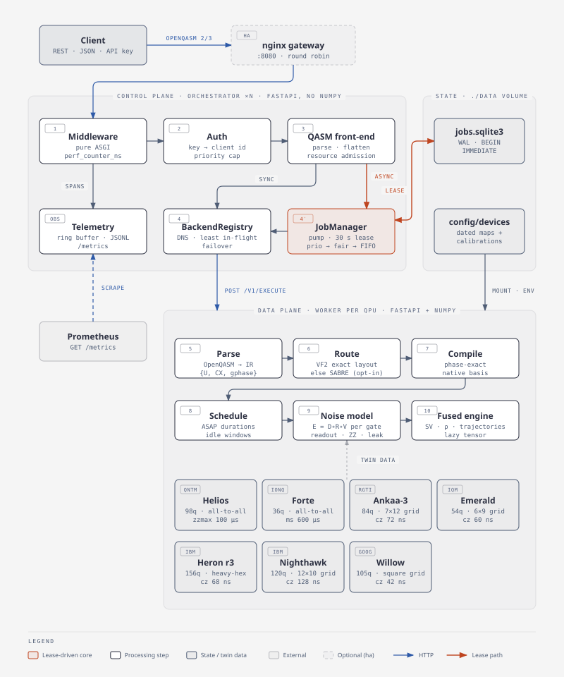
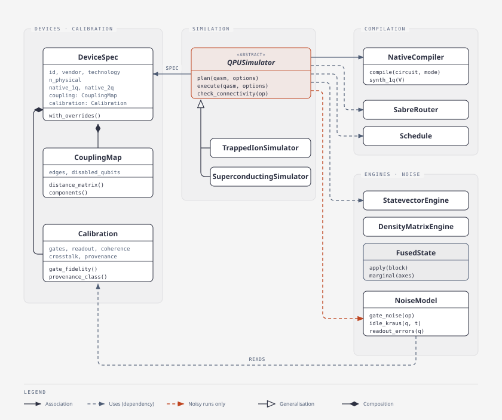
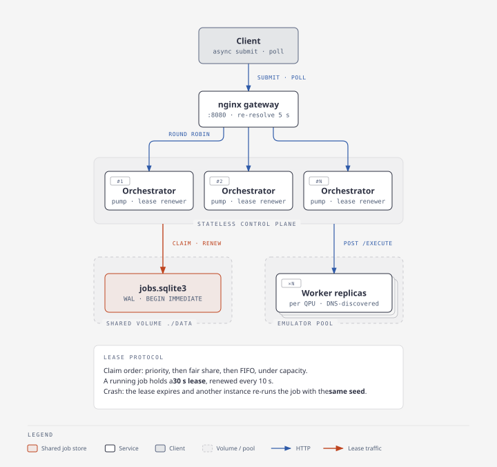
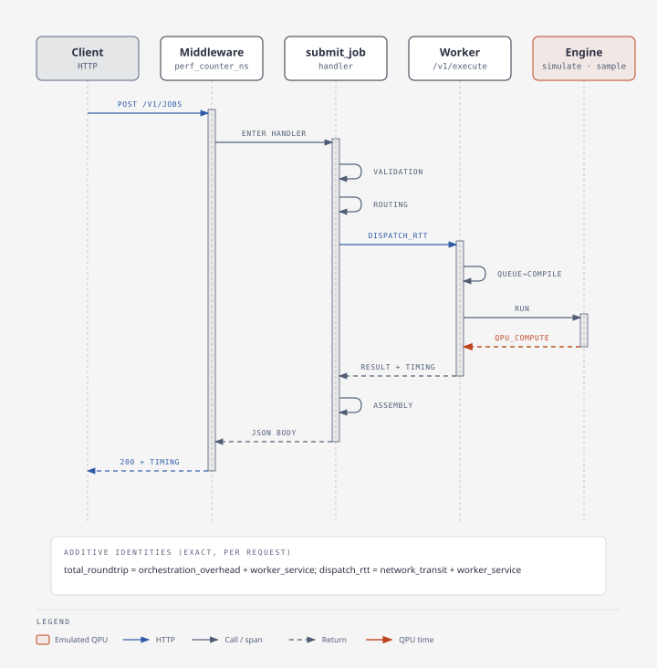
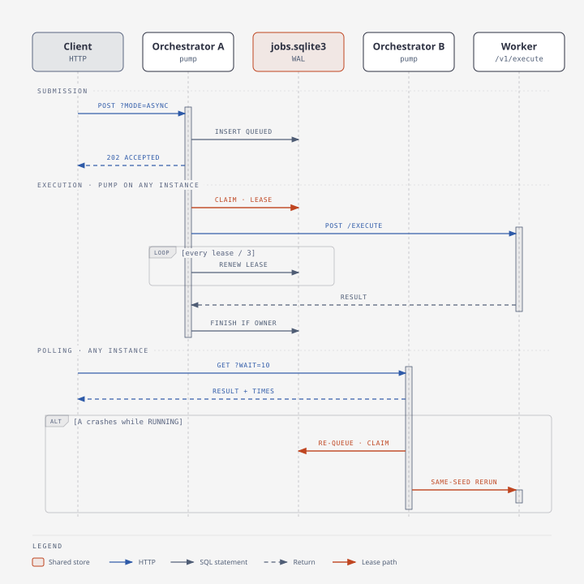

# Architecture

{ .qt-diagram }

## Components

### Orchestrator (`qputwin_orchestrator`)

It is the only service that publishes a host port (8000), and it ships **without numpy**: its OpenQASM front-end is pure Python.

| Module | Responsibility |
|---|---|
| `middleware.py` | Pure-ASGI `BenchmarkingMiddleware`: stamps `t0` with `perf_counter_ns`, adds `Server-Timing` and `X-QPUTwin-Job-Id`, and records each job in the dataset |
| `app.py` | Routes, authentication, validation (parse, flatten, size and shot limits), dispatch, error envelope |
| `registry.py` | Backends → worker replicas; DNS discovery; least-in-flight balancing; connect-failover |
| `jobs.py` | Asynchronous job manager and stores (`memory`, `sqlite`): leases, priority, fair share |
| `telemetry.py` | Additive span recorder, ring buffer, JSONL dataset sink |
| `metrics.py` | Prometheus exposition fed by the telemetry stream |

The orchestrator **parses but does not check topology**. Topology and native-gate checks belong to the emulator, as on real clouds, where the vendor-side compiler rejects the job. This split also lets *validation latency* and *emulator rejection latency* be measured separately.

### Workers (`qputwin_worker`)

There is one image for all seven worker services; `QPUTWIN_VENDOR` selects the device module. Each worker:

* applies runtime overrides (`QPUTWIN_COUPLING_MAP`, `QPUTWIN_CALIBRATION`) to its `DeviceSpec`;
* runs jobs one at a time by default (`QPUTWIN_WORKER_CONCURRENCY=1`), which models a QPU's serial queue;
* reports **durations only** (never timestamps), so clock skew between containers cannot enter the measurement.

### Physics core (`qputwin_core`)

It is shared by both services and also usable as a library.

{ .qt-diagram }

## Deployment topologies

| Topology | How | When |
|---|---|---|
| Single host, one orchestrator | `docker compose up -d` | development, benchmarking |
| Scaled workers | `QPUTWIN_<DEVICE>_REPLICAS=3` or `--scale worker-…=3` | throughput |
| HA orchestrators | `--profile ha` with `QPUTWIN_ORCHESTRATOR_REPLICAS=N` | availability |

{ .qt-diagram }

See [Scaling & high availability](../operations/scaling.md).

## Request paths

=== "Synchronous"

    { .qt-diagram }

=== "Asynchronous"

    { .qt-diagram }
