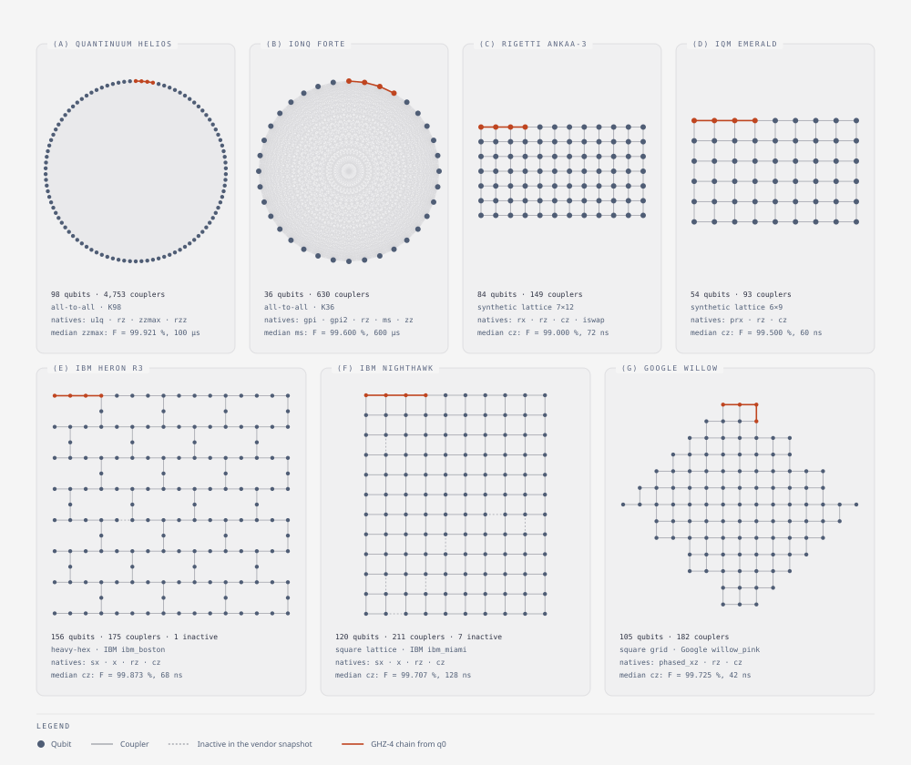

# Emulated devices

| Backend ID | Device | Technology | Qubits | Connectivity | Native 1Q | Native 2Q | CX realised with |
|---|---|---|---|---|---|---|---|
| `quantinuum_helios` | Quantinuum Helios | Trapped ion (¹³⁷Ba⁺, QCCD) | 98 | all-to-all $K_{98}$ | `u1q(θ,φ)`, virtual `rz` | `zzmax`, `rzz(θ)` | 1 × ZZMax |
| `ionq_forte` | IonQ Forte | Trapped ion (¹⁷¹Yb⁺) | 36 | all-to-all $K_{36}$ | `gpi(φ)`, `gpi2(φ)`, virtual `rz` | `ms(φ₀,φ₁,θ)`, `zz(θ)` | 1 × MS |
| `rigetti_ankaa_3` | Rigetti Ankaa-3 | Superconducting transmons | 84 | 7 × 12 square lattice | `rx(kπ/2)`, virtual `rz` | `cz`, `iswap` | 1 × CZ |
| `iqm_emerald` | IQM Emerald | Superconducting transmons | 54 | 6 × 9 square lattice | `prx(θ,φ)`, virtual `rz` | `cz` | 1 × CZ |
| `ibm_heron` | IBM Heron r3 (`ibm_boston`) | Superconducting transmons | 156 | heavy-hex, 175 of 176 couplers | `sx`, `x`, virtual `rz` | `cz` | 1 × CZ |
| `ibm_nighthawk` | IBM Nighthawk r1 (`ibm_miami`) | Superconducting transmons | 120 | 12 × 10 square lattice, 211 of 218 couplers | `sx`, `x`, virtual `rz` | `cz` | 1 × CZ |
| `google_willow` | Google Willow (`willow_pink`) | Superconducting transmons | 105 | square grid, 182 couplers | `phased_xz(θ,φ,ζ)`, virtual `rz` | `cz` | 1 × CZ |

## Gate definitions

| Gate | Matrix / definition |
|---|---|
| `U(θ,φ,λ)` | OpenQASM 2 definition $\begin{pmatrix}\cos\frac\theta2 & -e^{i\lambda}\sin\frac\theta2\\ e^{i\phi}\sin\frac\theta2 & e^{i(\phi+\lambda)}\cos\frac\theta2\end{pmatrix}$ |
| `u1q(θ,φ)`, `prx(θ,φ)` | $R(\theta,\phi) = e^{-i\frac\theta2(\cos\phi X + \sin\phi Y)}$ |
| `sx`, `x` | $\sqrt{X} = e^{i\pi/4}R_X(\pi/2)$ and $X = e^{i\pi/2}R_X(\pi)$; IBM synthesises any one-qubit gate as `rz · sx · rz · sx · rz` |
| `phased_xz(θ,φ,ζ)` | $R_Z(\zeta)\,R(\theta,\phi)$: Google's `cirq.PhasedXZGate(x_exponent=θ/π, axis_phase_exponent=φ/π, z_exponent=ζ/π)`, in radians, one 25 ns microwave pulse |
| `gpi(φ)` | $\begin{pmatrix}0 & e^{-i\phi}\\ e^{i\phi} & 0\end{pmatrix}$ |
| `gpi2(φ)` | $R(\pi/2,\phi)$ |
| `ms(φ₀,φ₁,θ)` | $e^{-i\frac\theta2\,\sigma_{\phi_0}\otimes\sigma_{\phi_1}}$, θ in radians (IonQ's API uses turns) |
| `rzz(θ)`, `zz(θ)` | $e^{-i\frac\theta2 Z\otimes Z}$; `zzmax` = `rzz(π/2)` |
| `cz`, `iswap` | standard |

Every closed form is checked against `scipy.linalg.expm` of its generator in the test suite.

## Connectivity

{ .qt-diagram }

The figure shows all seven twins. The IBM and Google maps also carry each qubit's position in `coupling_map.layout` (`coordinates` for Heron and Willow, `rows` × `cols` for Nighthawk); notebook 01 draws them.

* **Trapped ion.** Any pair of distinct qubits may interact; the complete graph is stored implicitly.
* **Superconducting.** A symmetric boolean adjacency matrix `A` is held as a numpy array. Every pair of qubits touched by every multi-qubit operation, *after* library expansion, must satisfy `A[p, q] = 1`. A `ccx` therefore cannot run on a square lattice, because the lattice has no triangles.

On a row-major lattice (Ankaa-3, Emerald, Nighthawk), qubit `(r, c)` has index `r·cols + c`. On Willow, index *i* is the *i*-th `GridQubit` in (row, column) order, and on Heron the rows of 16 qubits are joined by bridge qubits, as in IBM's numbering. Inspect any coupling map with:

```bash
curl -s localhost:8000/v1/backends/rigetti_ankaa_3 | python3 -c \
  'import json,sys; d=json.load(sys.stdin); print(d["coupling_map"]["n_edges"], d["coupling_map"]["degree"])'
```

!!! warning "Methods note: which coupling maps are synthetic"
    The Rigetti and IQM maps are **synthetic** nearest-neighbour lattices that match each device's published qubit count and connectivity class. They are not vendor calibration snapshots, which would contain defective qubits and couplers. Load a real map at runtime, with no code change; see [Calibration data](../guide/calibration.md).

    The IBM Heron, IBM Nighthawk and Google Willow maps are the **vendors' published maps**. IBM's couplers reported as not working in the snapshot (`cz` error = 1) are removed and listed in `layout.inactive_couplers`.

## Calibration at a glance

| Device | Published values used | Assumed placeholders |
|---|---|---|
| Quantinuum Helios | 1Q 99.9975 %, 2Q 99.921 % (Quantinuum launch blog); SPAM 99.967 % (Sandia/Quantinuum benchmark) | all durations; QCCD transport and gate-zone parallelism not modelled; T1/T2 not modelled (hyperfine coherence far exceeds circuit times) |
| IonQ Forte | 1Q 99.98 %, 2Q 99.6 %, SPAM 99.5 % (IonQ Forte system page) | gate times (IonQ *Aria* figures 135 µs / 600 µs), readout/reset times, T1 = 10 s and T2 = 1 s (Aria), one entangling gate at a time |
| Rigetti Ankaa-3 | median iSWAP 99.0 % at 72 ns (Ankaa-3 launch) | CZ = iSWAP fidelity; 1Q fidelity and duration; readout; T1 = 30 µs, T2 = 20 µs |
| IQM Emerald | median CZ 99.5 %, 1Q 99.93 % (IQM / Amazon Braket launch); T1 = 54.7 µs, T2 = 16.6 µs (arXiv:2608.30176) | durations; readout fidelity (IQM Radiance typical value) |
| IBM Heron r3 | IBM's `ibm_boston` calibration snapshot (2026-04-17), per qubit and per coupler: T1, T2, readout p01/p10 and length, `sx`/`x` error and length, `cz` error and length; median CZ error 1.27 × 10⁻³ (45 couplers below 10⁻³), 68 ns; rep delay 250 µs | T2 clipped to 2·T1 on 3 qubits |
| IBM Nighthawk | IBM's `ibm_miami` calibration snapshot (2026-04-17), same fields; median CZ error 2.93 × 10⁻³, median T1 330 µs; rep delay 4 ms | reset duration (no reset in the snapshot; a readout length is used); T2 clipped on 1 qubit |
| Google Willow | Google's `willow_pink` device specification and calibration snapshot (2024-08-16), per qubit and per coupler: idle T1, readout p00/p11 errors, RB and CZ XEB Pauli errors (converted to average error); PhasedXZ 25 ns, CZ 42 ns, readout 600 ns, reset 160 ns | T2, derived from the RB incoherent error with Cirq's formula (Google publishes none); the CZ error is the per-cycle XEB error, so it includes a single-qubit layer |

`GET /v1/backends/{id}` returns the complete calibration, including a `provenance` tag for every field.

## The IBM and Google twins

IBM and Google publish real calibration snapshots of their processors inside their SDKs: `qiskit-ibm-runtime` holds IBM backend properties and coupling maps, and `cirq-google` holds Willow's device specification and a median calibration. `scripts/import_vendor_snapshots.py` converts them, offline, into QPUTwin's packaged files; QPUTwin itself still uses no vendor SDK at run time. Run it again to refresh the snapshot, or to import another system of the same family:

```bash
uv run --no-project --with qiskit-ibm-runtime==0.51.0 --with cirq-google==1.7.0 \
    python scripts/import_vendor_snapshots.py --heron fake_pittsburgh -o config/devices
```

The twins were checked against the vendors' own tools ([simulator comparison](../research/simulator-comparison.md#5-the-vendors-own-noise-models)):

* every native operation the twins emit after SABRE routing is supported by IBM's `Target` for `ibm_boston` and `ibm_miami`, and every routed Willow circuit passes `cirq_google`'s `willow_pink` `device.validate_circuit`; the coupling maps equal the vendors' maps, minus IBM's inactive couplers;
* compiled circuits equal their sources to about 10⁻¹⁵, computed with Qiskit's `Operator` and `cirq.unitary`;
* on 33 circuits per twin, run unchanged on the same physical qubits, the twins reproduce the vendors' own noise models of the same snapshots to a median Hellinger-fidelity difference of 0.0014 (Heron, Qiskit Aer `from_backend`), 0.0011 (Nighthawk) and 0.0014 (Willow, Cirq), at most 0.026. A twin built from the same snapshots' device medians differs by up to 0.06–0.16, because medians cannot see which qubits are poor.
* Cirq's model of Willow also decays qubits for the 600 ns of every measurement, on top of a measured readout error that already contains that decay; QPUTwin does not count it twice, so Cirq as shipped predicts 0.027 lower fidelity on average.

These are checks against the vendors' published models, not against hardware.
