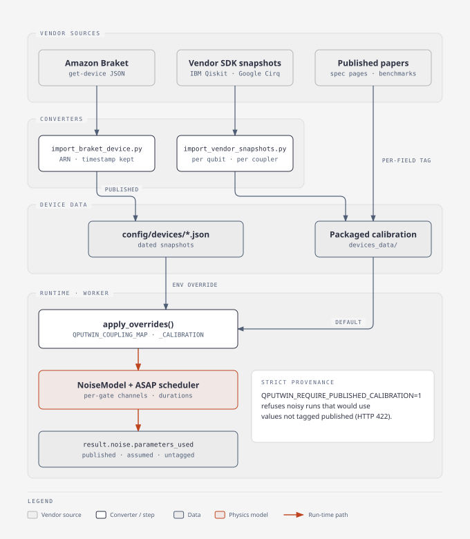

# Quantum digital twins

A **digital twin** of a quantum processing unit (QPU) is a classical model faithful enough to stand in for the hardware in a given study. QPUTwin builds one for each of seven commercial QPUs and reproduces them on five layers:

| Layer | What is reproduced | Where |
|---|---|---|
| **Instruction set** | the vendor's native gate set, with its parameter conventions and calibrated angle grids (`strict` mode) | [Native compilation](../guide/compilation.md) |
| **Connectivity** | the coupling graph as a boolean adjacency matrix, including defective qubits and couplers of a calibration snapshot | [Devices](devices.md) |
| **Noise** | every gate's published average fidelity (exactly), T1/T2, idle decoherence, coherent error, crosstalk, leakage, quasi-static drift, reset and readout errors | [Noise models](../guide/noise.md) |
| **Timing** | calibrated gate, readout and reset durations, parallelism limits, QCCD transport, and a fixed-timeline schedule | [Gate-duration model](../guide/timing.md) |
| **Service behaviour** | vendor-style rejection of illegal circuits, queueing, asynchronous jobs, and measurable latency | [Asynchronous jobs](../guide/async-jobs.md), [Telemetry](../guide/telemetry.md) |

## "Calibration-faithful"

The noise model is not tuned by hand. For every physical gate, QPUTwin builds an error channel $\mathcal{E} = \mathcal{D}_p \circ \mathcal{R} \circ \mathcal{V}$ (coherent error, then thermal relaxation, then depolarising) and **solves** for the depolarising strength $p$ so that the whole channel reproduces the vendor's published average gate fidelity *exactly*:

$$
p \;=\; \frac{F_e(\mathcal{R}\circ\mathcal{V}) - F_e^{\text{target}}}{F_e(\mathcal{R}\circ\mathcal{V}) - 1/d^2},
\qquad
F_e^{\text{target}} = \frac{(d+1)\,F_{\text{avg}} - 1}{d}.
$$

Relaxation and coherent error are therefore never double counted. The derivation is on the [Noise models](../guide/noise.md#the-error-budget-is-solved-not-tuned) page, and the [validation suite](../research/validation.md) checks the identity on a Choi state.

## Provenance: what is real data and what is a placeholder

Vendors publish some numbers (median 2Q fidelity, sometimes T1/T2) and not others (most gate durations, per-shot overheads). QPUTwin never hides this gap:

* every value in a calibration file carries a tag, `published: <source>` or `assumed: <reason>`;
* every noisy result lists `parameters_used` grouped into `published`, `assumed` and `untagged`;
* with `QPUTWIN_REQUIRE_PUBLISHED_CALIBRATION=1` a worker **refuses** noisy runs that would rely on unpublished values;
* a dated vendor snapshot replaces the packaged medians in one command (`scripts/import_braket_device.py`).

{ .qt-diagram }

## What a twin is not

QPUTwin is a *gate-level* model. It does not simulate pulses or control electronics, and it treats leakage phenomenologically. These boundaries are listed explicitly on [Limitations](../research/limitations.md).
