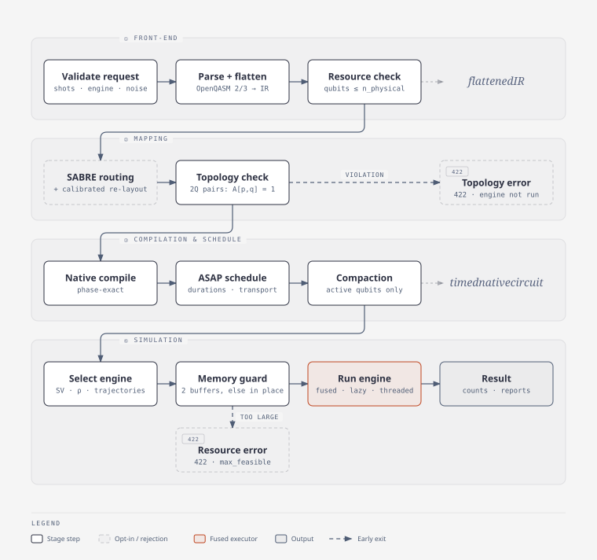
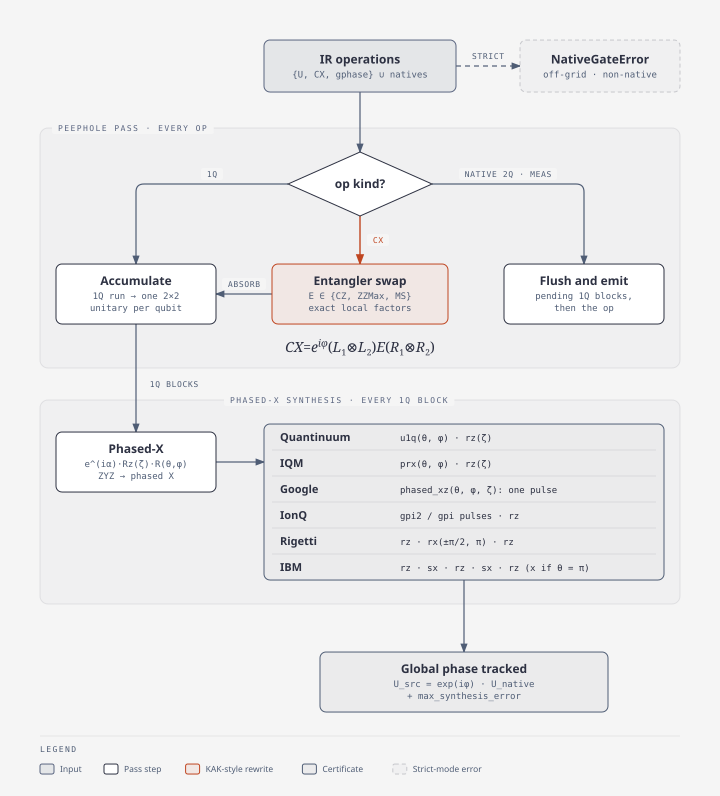

# Execution pipeline

Every job, synchronous or asynchronous, goes through the same pipeline inside the worker (`QPUSimulator.plan` → `execute`).

{ .qt-diagram }

## Stages

| # | Stage | Module | Can fail with |
|---|---|---|---|
| 1 | Request validation (shots, precision, engine, routing and noise options) | `simulators` | `InvalidRequestError` 400 |
| 2 | Parse and flatten OpenQASM to the primitive IR `{U, CX, gphase}` ∪ device natives | `qasm` | `QASMSyntaxError`, `QASMSemanticError`, `UnsupportedFeatureError` 400 |
| 3 | Resource check: declared qubits ≤ `n_physical` | `simulators` | `ResourceLimitError` 422 |
| 4 | Optional SABRE routing | `routing` | `ResourceLimitError` (no connected region large enough) |
| 5 | Topology check: disabled qubits, adjacency of every 2-qubit pair | `simulators` | `TopologicalCompilationError` 422 |
| 6 | Native compilation (phase-exact), or `strict` validation | `synthesis` | `NativeGateError` 422 |
| 7 | ASAP gate-duration schedule | `scheduling` | — |
| 8 | Active-qubit compaction and measurement classification | `engine.prepare` | `ResourceLimitError` (over `QPUTWIN_MAX_SIM_QUBITS`) |
| 9 | Noise program and engine selection | `noise`, `simulators` | `InvalidRequestError`, `CalibrationProvenanceError` 422 |
| 10 | Memory-feasibility guard | `simulators` | `ResourceLimitError` 422 (with `max_feasible_qubits`) |
| 11 | Run the engine and sample | `engine`, `density`, `trajectory` | — |

## Key mechanisms

### The primitive IR

The flattener inlines `qelib1.inc` / `stdgates.inc` down to `U`, `CX` and `gphase`, which is exactly the basis the OpenQASM specification defines its library in. Vendor-native gates (`u1q`, `gpi`, `ms`, `prx`, `cz`, …) are kept opaque, so they map 1:1 onto hardware gates. Every operation keeps an `origin` (the user's statement and line), so errors quote what *you* wrote, not an internal decomposition.

### Active-qubit compaction

Only qubits touched by a gate or reset are simulated. A 5-qubit circuit on Helios qubits 70–74 simulates 5 qubits, not 98. Qubits that are only measured are known to be $|0\rangle$ and cost nothing; with noise, their readout error is still sampled.

### Measurement classification

| Kind | Meaning | How it is sampled |
|---|---|---|
| terminal | last op on the qubit, and its bits are not read later | one simulation, then all shots sampled from the marginal |
| dead | overwritten by a later measurement into the same bits | skipped |
| idle | the qubit was never gated (exactly $|0\rangle$) | deterministic 0, plus readout error |
| mid-circuit | the qubit is used later, or its bits feed a condition | **shot branching**: binomial split of the shot budget per outcome |

Shot branching samples exactly the per-shot distribution at the cost of one simulation per *distinct reachable classical branch*. Teleportation, for example, needs 4 branches regardless of the shot count.

### Native compilation

{ .qt-diagram }

See [Native compilation](../guide/compilation.md) for vendor details and `strict` mode.
