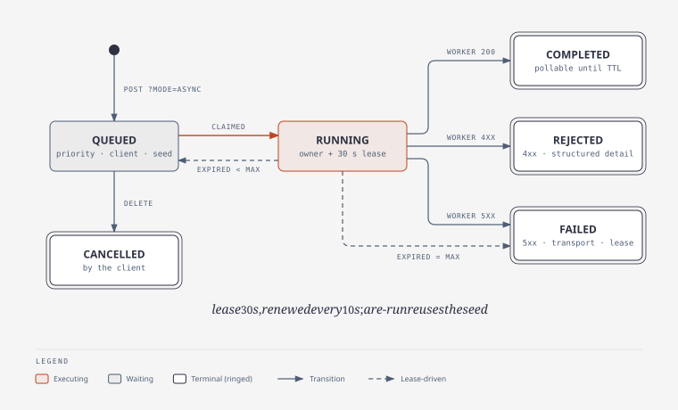
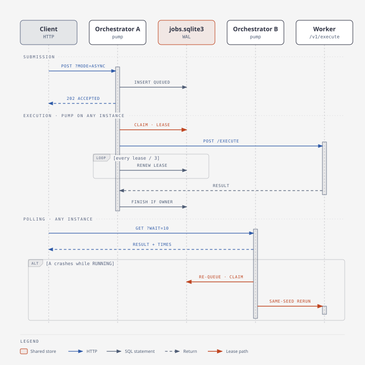

# Asynchronous jobs

Use asynchronous execution for long jobs (wide or noisy circuits), batch submissions, or when your client cannot hold an HTTP connection open.

## Life cycle

{ .qt-diagram }

## Submit

```bash
curl -si 'localhost:8000/v1/jobs?mode=async' -H 'content-type: application/json' -d @job.json
# or: -H 'Prefer: respond-async'
```

```http
HTTP/1.1 202 Accepted
Location: /v1/jobs/9b2e…
Retry-After: 1

{"job_id": "9b2e…", "backend": "ionq_forte", "status": "QUEUED", "execution_mode": "async",
 "client": "anonymous", "priority": 5, "submitted_at": "2026-10-24T15:40:12.531Z",
 "queue_position": 1, "links": {"self": "/v1/jobs/9b2e…"}}
```

Validation is **synchronous**. Malformed OpenQASM, unknown backends and resource violations are rejected immediately with the normal error envelope, and only valid jobs are queued. A full queue returns `503 QueueFullError`.

## Poll and long-poll

```bash
curl -s "localhost:8000/v1/jobs/$JOB"            # immediate status
curl -s "localhost:8000/v1/jobs/$JOB?wait=10"    # wait up to 10 s (capped by QPUTWIN_MAX_POLL_WAIT_S = 30)
```

While the job is `QUEUED` or `RUNNING` you get the summary (including `queue_position`) and a `Retry-After` header. Once it finishes, you get **exactly the body a synchronous call would have returned**, plus `submitted_at`, `started_at`, `finished_at`, `http_status`, `attempts`, `client` and `priority`.

```python
import httpx, time

c = httpx.Client(base_url="http://localhost:8000", timeout=60)
job = c.post("/v1/jobs", params={"mode": "async"}, json=payload).json()
while True:
    body = c.get(f"/v1/jobs/{job['job_id']}", params={"wait": 20}).json()
    if body["status"] not in ("QUEUED", "RUNNING"):
        break
print(body["status"], body.get("result", {}).get("counts"))
```

## Cancel and list

```bash
curl -s -X DELETE "localhost:8000/v1/jobs/$JOB"      # only QUEUED jobs; RUNNING → 409 JobStateError
curl -s "localhost:8000/v1/jobs?status=QUEUED&backend=ionq_forte&limit=50"
```

`GET /v1/jobs` also returns `queues`: the queued, running and capacity counts per backend, across all orchestrator instances.

## Scheduling: capacity, priority, fair share

Each backend has a dispatch **capacity** of `replicas × QPUTWIN_ASYNC_PER_REPLICA_CONCURRENCY` (default 1 slot per worker replica), enforced globally across orchestrator instances. When a slot frees up, the next job is chosen by:

1. **priority**: the request's `priority` field (0–9, 9 first), capped by the API key's maximum;
2. **fair share**: the client with the fewest running jobs on that backend goes first; on a tie, the client served least recently there. With one dispatch slot this is round-robin between active clients, so a client that queues hundreds of jobs cannot delay another client by more than about one job per turn ([measured](../research/load-testing.md#fair-share-isolation));
3. **FIFO**: submission order.

The client identity is the API-key name when [authentication](../operations/security.md) is on, otherwise the `X-QPUTwin-Client` header (default `anonymous`). With API keys, every client sees only its own jobs.

## Durability, leases and recovery

With `QPUTWIN_JOB_STORE=sqlite` (the Compose default), jobs live in `./data/jobs.sqlite3`:

* Jobs survive orchestrator restarts.
* Several orchestrator instances share one queue; every transition is a single `BEGIN IMMEDIATE` transaction.
* A running job holds a **lease** (`QPUTWIN_JOB_LEASE_S`, default 30 s), renewed every lease/3.
  * Graceful stop: the lease is released immediately.
  * Crash: the lease expires and another instance re-runs the job, up to `QPUTWIN_JOB_MAX_ATTEMPTS` (default 3) executions; then the job is `FAILED` as abandoned.
* Delivery is **at-least-once**. Re-execution is idempotent: the seed is fixed at submission, so a retry returns identical counts. A stale owner's late result is discarded.

## Retention

Finished jobs stay pollable for `QPUTWIN_ASYNC_TTL_S` (default 3600 s), up to `QPUTWIN_ASYNC_RETENTION` jobs; after that, `GET` returns `404 JobNotFoundError`. Every job is also recorded once in the telemetry dataset when it finishes.

## Telemetry for asynchronous jobs

The same additive identities hold. `orchestrator_queue_ms` measures the wait in the queue.

* `queue_clock: "perf_counter"`: the accepting instance also executed the job, so every span uses the same monotonic clock.
* `queue_clock: "realtime"`: another instance (or a restarted one) executed it. The pre-dispatch spans come from the store, and the queue time uses the host's realtime clock, which containers on one host share.
* `attempt` counts executions.

{ .qt-diagram }
