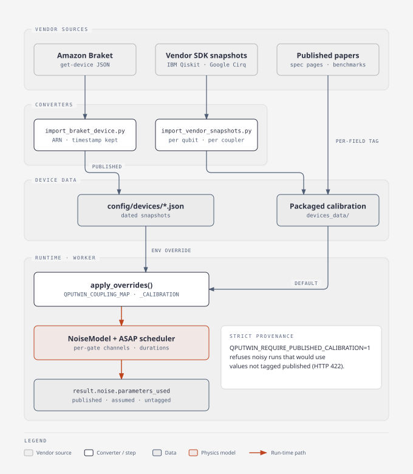

# Calibration data

Each device ships a packaged calibration with nominal medians (`src/qputwin_core/devices_data/calibration/<id>.json`) and a coupling map (`devices_data/*.json`). Both can be replaced **at runtime**, with no code change.

{ .qt-diagram }

## Provenance

Every value carries a tag:

* `published: <source>`: a vendor or peer-reviewed number, with its citation;
* `assumed: <reason>`: a placeholder typical of the technology class. **Do not quote results that depend on these without replacing them.**

Tags are served at `GET /v1/backends/{id}` under `calibration.provenance`, and every noisy result lists the paths it used in `result.noise.parameters_used`. Lookups take the most specific prefix (`gates.cz.fidelity` before `gates`), and `*` tags a whole file.

## Load a dated vendor snapshot (Amazon Braket)

```bash
aws braket get-device --device-arn arn:aws:braket:eu-north-1::device/qpu/iqm/Emerald > emerald.json
uv run python scripts/import_braket_device.py emerald.json --device iqm_emerald -o config/devices
#   wrote config/devices/iqm_emerald_2026-10-20_calibration.json
#   wrote config/devices/iqm_emerald_2026-10-20_coupling.json: 54 qubits, ... couplers
```

The importer reads:

* the connectivity graph (vendor labels map to dense indices, recorded in `layout.labels`);
* per-qubit T1/T2 (a measured T2 > 2·T1 is clipped, and the clip is recorded);
* randomized-benchmarking and readout fidelities;
* per-coupler two-qubit gate fidelities;
* IonQ's fidelity and timing provider properties.

Medians become device defaults. Every imported value is tagged `published: Amazon Braket device properties (<ARN>, updated <timestamp>)`. Values Braket does not publish (gate durations on the superconducting devices) keep the packaged value *and its tag*, so the gap stays visible.

!!! note
    The importer follows Braket's `standardized_gate_model_qpu_device_properties` v1/v2 schema and the IonQ provider schema. It is tested on payloads shaped like those schemas; check it on a real export first.

## Select the files

Put them in `config/devices/`, which is mounted read-only at `/app/config/devices`, and set in `.env`:

```dotenv
QPUTWIN_EMERALD_COUPLING_MAP=/app/config/devices/iqm_emerald_2026-10-20_coupling.json
QPUTWIN_EMERALD_CALIBRATION=/app/config/devices/iqm_emerald_2026-10-20_calibration.json
```

```bash
docker compose up -d --wait worker-iqm-emerald
curl -s localhost:8000/v1/backends/iqm_emerald?refresh=true | python3 -m json.tool | head -40
```

`environment.worker.coupling_map` and `environment.worker.calibration` in every telemetry record name the files the job ran with.

## Other coupling-map formats

```bash
uv run python scripts/import_coupling_map.py vendor_map.json --device rigetti_ankaa_3 \
    --provenance "Rigetti Ankaa-3 calibration 2026-10-01" --disabled 5 30 -o config/devices/ankaa3.json
```

Accepted inputs:

* Qiskit-style pair lists `[[0,1],[1,2],…]`;
* objects with `edges`, `coupling_map`, `couplers` or `connectivity` (IQM `QB<n>` labels are sorted naturally);
* text edge lists.

Options: `--disabled` marks defective qubits, `--disable-isolated` disables qubits with no couplers, and `--keep-indices` keeps integer labels.

## Defective qubits and couplers

A coupling map may list `disabled_qubits`:

* Such qubits lose every coupler.
* Any operation on them is rejected with `TopologicalCompilationError` (`details.reason = "disabled_qubit"`).
* The [router](routing.md) avoids them.
* A removed coupler is simply absent from `edges`.

## Strict provenance

```dotenv
QPUTWIN_REQUIRE_PUBLISHED_CALIBRATION=1
```

Noisy runs that would use any non-`published` value fail with `422 CalibrationProvenanceError`, and `details.unpublished_parameters` lists them. Request overrides (`options.noise.*`) are allowed, because you supply them. Ideal runs are never blocked.

The complete file format is on [Calibration file format](../reference/calibration-format.md).
