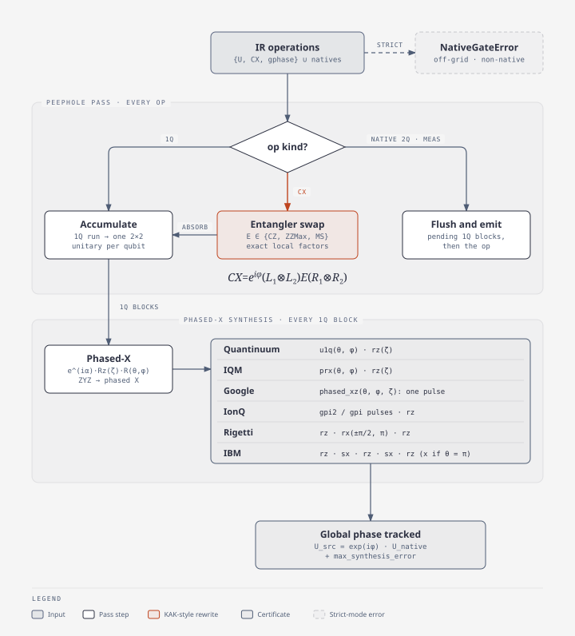

# Native compilation

{ .qt-diagram }

## `native` mode (default)

1. Runs of one-qubit gates are fused per qubit into one 2×2 matrix.
2. Each `CX` becomes $e^{i\varphi}(L_1\otimes L_2)\,E\,(R_1\otimes R_2)$, where $E$ is the device entangler: **one** CZ (Rigetti, IQM), one ZZMax (Quantinuum) or one MS (IonQ). The local factors merge into the neighbouring fused blocks.
3. Each fused block is re-synthesised through ZYZ Euler angles into the phased-X normal form $V = e^{i\alpha}\,R_z(\zeta)\,R(\theta,\phi)$ and realised natively:

| Vendor | Realisation |
|---|---|
| Quantinuum | `u1q(θ, φ)` · `rz(ζ)` |
| IQM | `prx(θ, φ)` · `rz(ζ)` |
| IonQ | `gpi2(φ)` for θ = π/2, `gpi(φ)` for θ = π, otherwise `gpi2 · rz(θ) · gpi2`; then `rz(ζ)` |
| Rigetti | `rz · rx(±π/2 or π) · rz`, or a two-pulse form; then `rz(ζ)` |

Adjacent `rz` gates merge, angles wrap to (−π, π], and identities are dropped.

### Phase exactness and the synthesis certificate

Every rewrite tracks its global phase, so $U_{\text{source}} = e^{i\cdot\text{global\_phase}}\,U_{\text{native}}$ exactly. The synthesis error of each one-qubit block is measured during compilation, and the maximum is reported as `compilation.max_synthesis_error` (typically ~1e-16). That makes it a per-job numerical certificate of exactness. All twins therefore return identical statevectors for any circuit they can all run.

## `strict` mode

```json
{ "options": { "compilation": "strict" } }
```

The circuit must already use only native gates. Anything else raises `422 NativeGateError`, naming the gate, its line and the device's native set. On Rigetti, `rx` must also use a calibrated angle from the grid {−π, −π/2, π/2, π}.

```text
OPENQASM 2.0;
qreg q[2]; creg c[2];
gpi2(0) q[0];
ms(0,0,pi/2) q[0],q[1];
measure q -> c;
```

This program passes `strict` on `ionq_forte`; `h q[0];` would not. `strict` cannot be combined with [routing](routing.md), because SWAPs are not native gates.

## Compilation statistics

| Field | Meaning |
|---|---|
| `native_gate_histogram` | counts per native gate |
| `native_op_count` / `native_physical_op_count` / `native_virtual_op_count` | all native gates; physical pulses only; frame changes (`rz`) only |
| `native_two_qubit_count`, `two_qubit_depth` | entangler count and entangler-only depth |
| `native_depth` | depth ignoring virtual gates and barriers |
| `input_gate_count`, `input_multi_qubit_gate_count` | the source circuit after library expansion |
| `global_phase`, `max_synthesis_error` | phase bookkeeping and the exactness certificate |
| `physical_qubits_used`, `simulated_qubits`, `idle_measured_qubits` | qubit accounting after active-qubit compaction |
