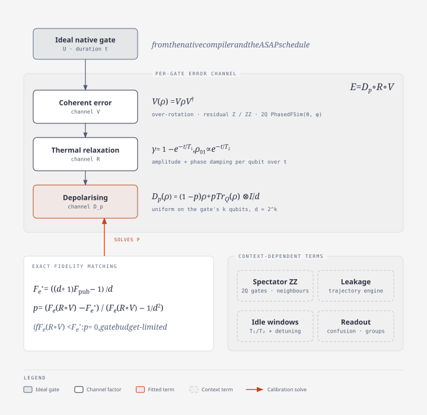

# Noise models

Add `"noise": {"model": "device"}` to `options` and the job runs with error channels derived from the backend's [calibration](calibration.md):

```json
{ "backend": "iqm_emerald", "qasm": "...", "shots": 10000,
  "options": { "noise": { "model": "device" } } }
```

{ .qt-diagram }

## The error budget is solved, not tuned

After every **physical** gate $U$ (virtual `rz` frame changes are noiseless), QPUTwin applies

$$\mathcal{E} = \mathcal{D}_p \circ \mathcal{R} \circ \mathcal{V}$$

| Term | Model | Parameters |
|---|---|---|
| $\mathcal{V}$, coherent error | over-rotation $U^{\varepsilon}$ (a rotation by θ becomes θ(1+ε), via the principal matrix logarithm), then a residual $R_Z(\phi)$ (1Q) or $R_{ZZ}(\phi)$ (2Q), then on two-qubit gates a residual $\mathrm{PhasedFSim}(\theta, \phi)$ | `overrotation`, `coherent_z_rad`, `fsim_theta_rad`, `fsim_phi_rad` |
| $\mathcal{R}$, thermal relaxation | amplitude damping $\gamma = 1-e^{-t/T_1}$, then pure dephasing so that coherences decay exactly as $e^{-t/T_2}$ | T1, T2, gate duration $t$ |
| $\mathcal{D}_p$, depolarising | $(1-p)\rho + p\,\mathrm{Tr}_Q(\rho)\otimes I/d$ | **solved** from the published fidelity |

With $F_e^{\text{target}} = \big((d+1)F_{\text{avg}} - 1\big)/d$ and the exact identities

$$F_e(\mathcal{D}_p\circ\mathcal{X}) = (1-p)\,F_e(\mathcal{X}) + \frac{p}{d^2},\qquad F_e(\mathcal{R}\circ\mathcal{V}) = \frac{1}{d^2}\sum_k \big|\mathrm{Tr}(K_k V)\big|^2,$$

QPUTwin solves

$$p = \frac{F_e(\mathcal{R}\circ\mathcal{V}) - F_e^{\text{target}}}{F_e(\mathcal{R}\circ\mathcal{V}) - 1/d^2}.$$

The **whole** channel therefore reproduces the published average gate fidelity exactly. Relaxation and coherent error are never double counted. If they alone already exceed the published error, $p = 0$ and the gate appears in `budget_limited_gates`.

## All noise terms

| Term | What it models | Engine | Calibration source |
|---|---|---|---|
| Depolarising | the remaining gate error after relaxation and coherent error | both | `gates.<g>.fidelity` |
| Relaxation (gates) | T1/T2 during each physical gate | both | `coherence`, `gates.<g>.duration_ns` |
| Idle relaxation | T1/T2 during every idle window of the [ASAP schedule](timing.md), up to the aligned final read-out | both | as above |
| Fixed-timeline slots | a conditional gate that does not fire still occupies its slot, so its qubits relax for that duration | both | durations |
| Coherent error | systematic over-rotation, residual Z / ZZ phase, residual swap angle and conditional phase (Willow publishes them per coupler) | both | `gates.<g>.overrotation`, `coherent_z_rad`, `fsim_theta_rad`, `fsim_phi_rad` |
| Crosstalk | during a 2Q gate on (a, b), each coupled spectator n gets $e^{-i\theta/2\,Z_x Z_n}$; an unsimulated spectator in $\|0\rangle$ reduces this to $R_Z(\theta)$ on x | both | `crosstalk.zz_rad_per_two_qubit_gate`, `crosstalk.pairs` |
| Reset error | after a reset, $\|1\rangle$ with probability $1-F_{\text{reset}}$ | both | `reset.fidelity` |
| Readout | confusion matrix $\begin{pmatrix}1-p_{01} & p_{10}\\ p_{01} & 1-p_{10}\end{pmatrix}$ per qubit | both | `readout`, `qubits.<q>.readout_*` |
| Correlated readout | a joint assignment matrix for qubits read together (idle members included) | both | `readout_correlations` |
| Leakage | phenomenological: leaves the qubit space; gates skipped; 2Q partner fully depolarised; reads `1`; returns with probability `seepage`; recovered by reset | trajectory | `gates.<g>.leakage`, `leakage.seepage_per_gate` |
| Quasi-static detuning | per-trajectory $\delta_q\sim\mathcal N(0,\sigma_q)$, phase $2\pi\delta_q t$ over every window: **time-correlated**, giving Gaussian rather than exponential Ramsey decay | trajectory | `coherence.quasi_static_detuning_khz` |

Mid-circuit measurements are exact too. The engine branches on the **recorded** (possibly wrong) bit, which drives feed-forward, while the state collapses on the true outcome.

## Options

Every field of `options.noise`, with its default and allowed range:

| Field | Type | Default | Range | Effect |
|---|---|---|---|---|
| `model` | string | `device` | `device` \| `ideal` | `ideal` is the same as omitting `noise` |
| `scale` | float | 1.0 | 0 … 100 | multiplies every error rate, decay rate and coherent angle; 0 gives an ideal run on the noisy engines |
| `depolarizing` | bool | true | | gate depolarising |
| `relaxation` | bool | true | | T1/T2 during gates |
| `idle` | bool | true | | T1/T2 (and detuning) during idle windows |
| `readout` | bool | true | | readout assignment errors |
| `coherent` | bool | true | | over-rotation and residual phases |
| `crosstalk` | bool | true | | spectator ZZ |
| `reset_errors` | bool | true | | imperfect reset |
| `correlated_readout` | bool | true | | joint readout matrices |
| `leakage` | bool | true | | leakage (trajectory engine) |
| `quasi_static` | bool | true | | quasi-static detuning (trajectory engine) |
| `one_qubit_fidelity` | float \| null | calibration | 0.5 … 1 | overrides every physical 1Q gate |
| `two_qubit_fidelity` | float \| null | calibration | 0.5 … 1 | overrides every 2Q gate |
| `readout_fidelity` | float \| null | calibration | 0.5 … 1 | symmetric readout override (disables correlated readout) |
| `reset_fidelity` | float \| null | calibration | 0.5 … 1 | |
| `t1_us`, `t2_us` | float \| null | calibration | > 0, with T2 ≤ 2·T1 | every qubit |
| `overrotation` | float \| null | calibration | −0.5 … 0.5 | fractional ε for every physical gate |
| `coherent_z_rad` | float \| null | calibration | −π … π | residual Z / ZZ phase per gate |
| `crosstalk_zz_rad` | float \| null | calibration | −π … π | spectator ZZ angle per 2Q gate |
| `leakage_rate` | float \| null | calibration | 0 … 0.5 | leak probability per gate and qubit |
| `seepage_rate` | float \| null | calibration | 0 … 1 | return probability per gate on a leaked qubit |
| `quasi_static_khz` | float \| null | calibration | ≥ 0 | σ of the detuning in kHz |
| `trajectories` | int \| null | min(shots, `QPUTWIN_MAX_TRAJECTORIES`) | 1 … 10⁶ | trajectory count (trajectory engine) |

## Recipes

=== "Device noise"

    ```json
    { "noise": { "model": "device" } }
    ```

=== "Noise sweep"

    ```python
    for s in (0, 0.5, 1, 2, 4):
        run("iqm_emerald", GHZ5, shots=50_000, options={"noise": {"scale": s}})
    ```

=== "One channel at a time"

    ```json
    { "noise": { "depolarizing": false, "relaxation": false, "idle": false, "readout": true } }
    ```

=== "What-if hardware"

    ```json
    { "noise": { "two_qubit_fidelity": 0.999, "readout_fidelity": 0.995, "t1_us": 200, "t2_us": 150 } }
    ```

=== "Non-Markovian dephasing"

    ```json
    { "noise": { "quasi_static_khz": 225, "relaxation": false }, "engine": "trajectory" }
    ```

## The noise report (`result.noise`)

| Field | Meaning |
|---|---|
| `engine` | `density_matrix` or `trajectory` |
| `features` | the terms that were actually active in this run |
| `per_gate` | per gate name: count, published fidelity, depolarising `p`, budget-limited flag, coherent flag, leakage rate |
| `estimated_success_probability` | the product of gate and readout fidelities, a first-order predictor |
| `purity`, `trace` | $\mathrm{Tr}\,\rho^2$ and $\mathrm{Tr}\,\rho$ (density-matrix engine) |
| `trajectories`, `shots_per_trajectory`, `exact_sampling`, `jumps`, `leak_events` | trajectory-engine diagnostics |
| `parameters_used` | every calibration path used, grouped into `published`, `assumed` and `untagged` |
| `assumed_parameters` | the non-published shortlist; quote results that depend on these with care |
| `budget_limited_gates` | gates whose relaxation or coherent error alone exceeds the published error |
| `missing_fidelities`, `missing_durations` | calibration gaps (those terms were skipped) |

!!! warning "ESP is a predictor, not the result"
    The [benchmarks](../research/benchmarks.md#ghz-fidelity) show the estimated success probability overestimating GHZ success on the superconducting twins (0.70 vs 0.61 at 10 qubits on Emerald). The ESP ignores idle decoherence and the T1 decay of the $|1\dots1\rangle$ branch; the density-matrix result includes both.

## Strict provenance

Set `QPUTWIN_REQUIRE_PUBLISHED_CALIBRATION=1` on a worker, and noisy runs that would use any value not tagged `published` fail with `422 CalibrationProvenanceError`, which lists the offending paths. Request overrides are allowed, because you supplied them. Ideal runs are never blocked.
