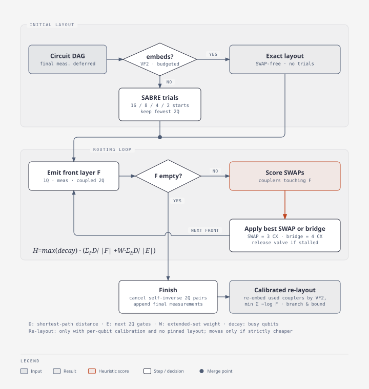

# Qubit routing

By default QPUTwin **rejects** circuits that violate a device's connectivity, as a vendor compiler does. That is the research stance: constraints are enforced, not hidden. Opt in to routing when you want to run such circuits and **measure what routing costs**.

```json
{ "options": { "routing": { "method": "sabre" } } }
```

{ .qt-diagram }

## Options

| Field | Type | Default | Range | Meaning |
|---|---|---|---|---|
| `method` | string | `sabre` | `sabre` \| `none` | `none` is the same as omitting `routing` |
| `initial_layout` | string \| list | `sabre` | `sabre`, `trivial`, or `[p₀, p₁, …]` | `sabre`: exact layout if one exists, else bidirectional layout search; `trivial`: logical i → physical i; a list maps logical i → `layout[i]` |
| `exact_layout` | bool | true | | first search for a SWAP-free embedding of the interaction graph (see below) |
| `exact_layout_budget` | int | 200 000 | 0 … 10⁷ | search steps before falling back to SABRE |
| `trials` | int | 0 (automatic) | 0 … 64 | SABRE layout trials; 0 = 16 up to 250 two-qubit gates, 8 up to 1 000, 4 up to 10 000, else 2. Each trial routes the whole circuit and the one with the fewest two-qubit gates is kept |
| `layout_iterations` | int | 2 | 0 … 16 | forward+backward refinement rounds per trial |
| `seed` | int | 0 | 0 … 2⁶³−1 | router RNG (independent of the shot seed) |
| `lookahead` | int | 20 | 0 … 1000 | size of the extended set E |
| `lookahead_weight` | float | 0.5 | 0 … 10 | weight W of E in the heuristic |
| `decay` | float | 0.001 | 0 … 1 | per-qubit penalty increment after a SWAP |
| `decay_reset` | int | 5 | 1 … 1000 | SWAPs between decay resets |
| `bridge` | bool | false | | execute distance-2 CX as a bridge when the best SWAP does not help E |
| `optimize` | bool | true | | commutation-aware cancellation after routing |
| `noise_aware` | bool | true | | after routing, move the circuit to the best-calibrated physical qubits with the same couplings (see below) |
| `noise_aware_budget` | int | 50 000 | 0 … 10⁷ | search steps of that calibrated re-layout |

The heuristic scores every SWAP on a coupler touching the front layer F:

$$H = \max(\text{decay}_p, \text{decay}_q)\left(\frac{1}{|F|}\sum_{g\in F} D[\pi(g)] + W\,\frac{1}{|E|}\sum_{g\in E} D[\pi(g)]\right)$$

where $D$ is the all-pairs shortest-path matrix. A release valve guarantees termination.

## Exact layout first

Before SABRE, the router looks for a placement that needs **no SWAPs at all**: an embedding of the circuit's interaction graph (logical qubits joined by every two-qubit gate) into the coupling graph. The search is a VF2-style backtracking subgraph match. Logical qubits are placed breadth-first from the busiest one; every candidate must be coupled to the images of its placed neighbours and have enough free degree; roots are tried from the centre of the chip outwards. A GHZ chain, a star or a nearest-neighbour ansatz that fits the lattice is therefore routed with zero SWAPs (`initial_layout_method: "exact"`). If no embedding exists, or `exact_layout_budget` runs out, SABRE runs as usual.

## Choosing among SABRE trials

Every trial (a compact BFS start plus seeded random starts, each refined by forward/backward passes) **routes the whole circuit and runs cancellation**. The trial whose emitted circuit has the fewest two-qubit gates (a SWAP counts as three CX) is kept. Scoring the real output, not an estimate, makes more trials monotonically better. `layout_trial_two_qubit_gates` reports every trial's cost.

## Calibration-aware re-layout

SABRE minimises SWAPs; it does not know which qubits are good. After routing, the router therefore looks for a better **placement of the routed circuit** on the same chip, as Qiskit's VF2PostLayout pass does. It searches for every injective map of the used physical qubits onto other physical qubits that keeps each used coupler a coupler (a subgraph monomorphism), and scores each candidate with the twin's own calibration:

$$C = \sum_{\text{couplers}} -\ln F_{2q}(e) + \sum_{\text{qubits}} -\ln F_{1q}(q) + \sum_{\text{measured}} -\ln\big(1-\bar\epsilon_{\text{ro}}(q)\big),$$

where $F_{2q}$ is the fidelity of the device's entangling gate on that coupler, $F_{1q}$ that of the first non-virtual one-qubit pulse on the qubit, and $\bar\epsilon_{\text{ro}}$ the mean read-out error. The search is branch and bound with an admissible lower bound, up to `noise_aware_budget` steps. The circuit moves only to a strictly cheaper placement, so the SWAP count, the gate list and the ideal output are unchanged, and the cost never rises.

* It runs only when the twin has per-qubit or per-coupler calibration (IBM Heron, IBM Nighthawk and Google Willow snapshots). Twins with device medians only (IQM Emerald, Rigetti Ankaa-3, IonQ Forte, Quantinuum Helios) have nothing to choose between.
* An explicit or `trivial` initial layout is a request to use those qubits; it is respected.
* The report adds `calibrated_relayout`: `applied`, `cost_before`, `cost_after`, `search_steps` and `search_complete`.

On the Heron snapshot, plain routing puts a 7-qubit GHZ state on qubit 46 (T₁ 8 µs, 8 % read-out error); the re-layout avoids it and raises the predicted GHZ fidelity by more than 0.05.

## What routing preserves

* **Semantics.** The routed circuit's output state equals the source's state relabelled by the final layout, to 1e-9 *including global phase*. This is tested on random circuits, with and without bridges.
* **Measurements and feed-forward.** The dependency DAG spans qubit *and* classical-bit wires.
* **Terminal measurements stay terminal.** Final measurements are deferred and mapped through the final layout, so the fast sampling path and `return_statevector` still apply.
* **Defective qubits** in a calibrated map are avoided. Logical qubits are placed inside one connected component; if none is large enough, the job fails with `ResourceLimitError`.

## Bridges and cancellation

* **Bridge:** `CX(a,m) CX(m,b) CX(a,m) CX(m,b)` executes CX(a, b) through a middle qubit m without changing the layout. It costs the same four CX as SWAP + CX.
* **Cancellation:** after routing, identical self-inverse two-qubit gates (CX, CZ, …) cancel in pairs when everything between them commutes with them. Commutation is checked **exactly** on the joint unitary (≤ 4 qubits).

## The routing report (`compilation.routing`)

| Field | Meaning |
|---|---|
| `swaps_inserted`, `bridges_inserted` | inserted SWAPs and bridges |
| `added_cx` | 3 × (SWAPs + bridges) |
| `cancelled_two_qubit_gates` | gates removed by the cancellation pass |
| `input_two_qubit_gates`, `routed_two_qubit_gates` | before and after routing |
| `initial_layout`, `final_layout` | `[logical, physical]` pairs |
| `initial_layout_method` | `exact`, `sabre`, `trivial` or `explicit` |
| `layout_trial_swaps`, `layout_trial_two_qubit_gates` | SWAPs and routed two-qubit gates of each SABRE trial |
| `release_valve_activations`, `deferred_final_measurements` | diagnostics |
| `calibrated_relayout` | calibration-aware re-layout: `applied`, `cost_before`, `cost_after`, `search_steps`, `search_complete` (absent when it did not run) |

`telemetry.breakdown.worker_route_ms` measures the routing time.

## Why there is no native SWAP or directed-coupler support

* **SWAP cost is already minimal.** A SWAP is lowered as three CX, i.e. three device entanglers. SWAP has KAK coordinates (π/4, π/4, π/4), so it needs three applications of *any* CZ-class entangler, iSWAP included.
* **Couplers are genuinely symmetric.** Every native entangler here (CZ, iSWAP, ZZMax/RZZ, MS) is symmetric in its two qubits, so a direction-aware router would have nothing to optimise.

## Example: the cost of routing

```python
for k in range(4, 15, 2):
    star = star_ghz(k)
    rejected = run("iqm_emerald", star)                            # 422
    routed = run("iqm_emerald", star, options={"routing": {"method": "sabre"}})
```

The [routing benchmark](../research/benchmarks.md#cost-of-routing) shows the trade-off. At k = 16 the routed square lattices need 26–32 entanglers and Heron's heavy-hex lattice 42, against 15 on the all-to-all twins, and the predicted success drops to 0.44–0.87. With the default 16 trials, routing also costs 0.5–34.5 ms of router time per job; fewer `trials` cut that time at the price of extra SWAPs.
