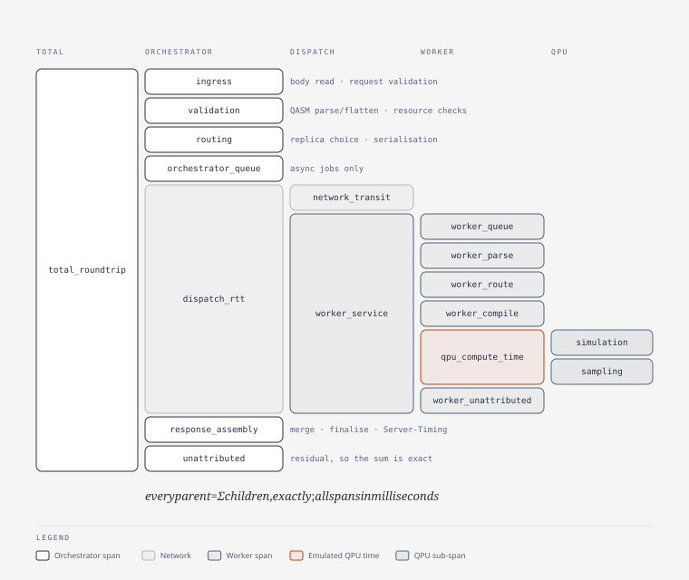
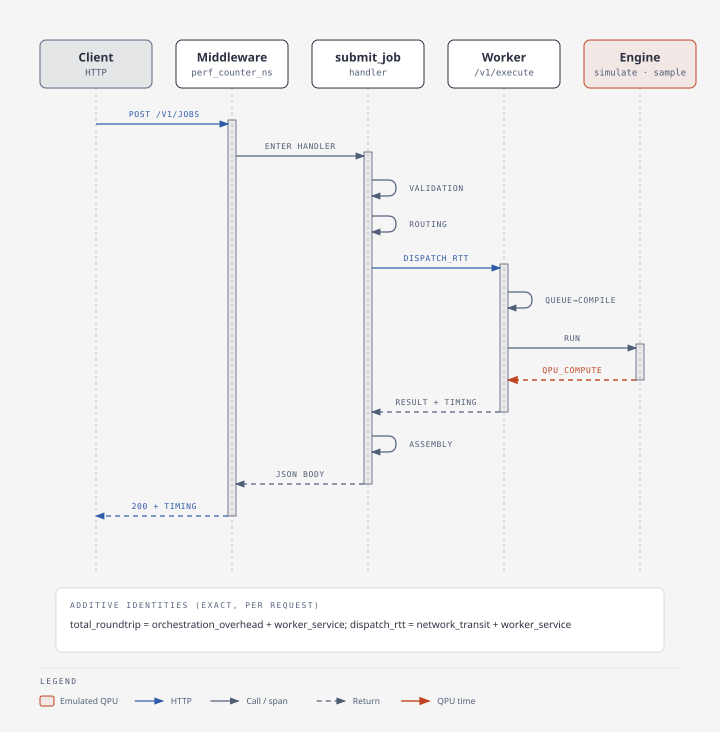

# Telemetry

Every response, **including errors**, carries a `telemetry` object whose components add up exactly to the server round trip.

{ .qt-diagram }

## Headline metrics

| Field | Definition |
|---|---|
| `total_roundtrip_ms` | from the moment the benchmarking middleware receives the request until the response object is ready, just before serialisation |
| `qpu_compute_time_ms` | time **inside the numpy engine**: `simulation_ms + sampling_ms`. It is `0.0` when the engine never ran, flagged by `engine_invoked: false` |
| `orchestration_overhead_ms` | `total_roundtrip_ms − worker_service_ms`: everything attributable to the orchestration layer |

## Identities (hold by construction; asserted by the tests)

$$
\begin{aligned}
\text{total\_roundtrip} &= \text{orchestration\_overhead} + \text{worker\_service}\\
\text{dispatch\_rtt} &= \text{network\_transit} + \text{worker\_service}\\
\text{qpu\_compute} &= \text{simulation} + \text{sampling}\\
\text{total\_roundtrip} &= \text{ingress} + \text{validation} + \text{routing} + \text{orchestrator\_queue} + \text{dispatch\_rtt} + \text{response\_assembly} + \text{unattributed}
\end{aligned}
$$

## Measurement design

* All durations come from `time.perf_counter_ns()` inside a single process. Workers report **durations, never timestamps**, so clock skew between containers cannot enter the measurement.
* The middleware is pure ASGI rather than Starlette's `BaseHTTPMiddleware`, which adds per-request overhead.
* `Server-Timing` (W3C) is measured **after** JSON serialisation; it complements the in-body total, which cannot include its own serialisation time.
* Access logging is off by default (`QPUTWIN_ACCESS_LOG=0`) because it perturbs latency.
* BLAS threads are pinned (`OMP_NUM_THREADS=1`), and every worker has identical CPU and memory limits.

{ .qt-diagram }

## Full object (schema 1.2)

A real response (a single call for a 12-qubit GHZ on Helios, 1024 shots; abridged where marked):

```json
{
  "schema_version": "1.2",
  "total_roundtrip_ms": 17.220, "orchestration_overhead_ms": 4.191, "qpu_compute_time_ms": 6.955,
  "engine_invoked": true, "execution_mode": "sync", "queue_clock": null, "attempt": 1,
  "breakdown": {
    "ingress_ms": 0.372, "validation_ms": 0.975, "routing_ms": 0.027, "orchestrator_queue_ms": 0.0,
    "dispatch_rtt_ms": 15.733, "network_transit_ms": 2.703, "worker_service_ms": 13.03,
    "worker_queue_ms": 0.003, "worker_parse_ms": 1.526, "worker_route_ms": 0.0, "worker_compile_ms": 3.4,
    "simulation_ms": 6.031, "sampling_ms": 0.923, "worker_unattributed_ms": 1.145,
    "response_assembly_ms": 0.079, "unattributed_ms": 0.034
  },
  "workload": { "simulated_qubits": 12, "engine": "statevector", "precision": "complex128",
                "state_bytes": 65536, "shots": 1024, "execution_path": "terminal_sampling", "...": "..." },
  "environment": { "orchestrator_version": "0.1.0", "python": "3.13.16", "replica": "http://172.18.0.3:8001",
                   "worker": { "worker_id": "…", "vendor": "quantinuum_helios", "numpy": "2.5.4",
                               "blas_threads": "1", "cgroup_cpu_limit": 4.0, "coupling_map": "packaged", "...": "..." } },
  "clock": "perf_counter_ns",
  "timestamp_utc": "2026-10-24T15:35:10.112Z"
}
```

This single call ran slower than the median of the [latency benchmark](../research/benchmarks.md#latency-decomposition) (6.39 ms for the same workload on Helios); always report distributions, not single calls.

## The research dataset

Every job is appended as one JSON line to `./data/telemetry.jsonl`, including rejected, failed and cancelled ones. Lines are written with a single `O_APPEND` write, so lines from several orchestrator processes never interleave.

* Synchronous records include the post-serialisation `server_timing_total_ms` and `response_complete_ms`.
* Asynchronous records are written once, when the job finishes, with `submit_response_ms`, the latency of the `202`.

```python
import json, pandas as pd
rows = [json.loads(l) for l in open("data/telemetry.jsonl")]
df = pd.json_normalize(rows)
df.groupby("backend")["telemetry.total_roundtrip_ms"].describe()
```

## Endpoints

| Endpoint | Returns |
|---|---|
| `GET /v1/telemetry?limit=100&backend=…` | the most recent records from this instance's ring buffer |
| `GET /v1/telemetry/summary` | per backend: n, mean, stdev, min, median, p95 and max of the headline metrics, plus status counts |
| `GET /metrics` | Prometheus counters and histograms, see [Monitoring](../operations/monitoring.md) |
