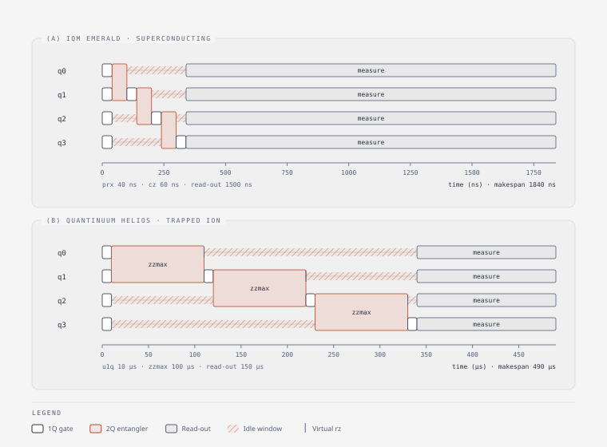

# Gate-duration model

Every compiled job carries `compilation.hardware_time_estimate`, computed by an **ASAP list schedule** over the native circuit (`qputwin_core.scheduling`).

{ .qt-diagram }

The figure is computed by the scheduler itself at build time. The same GHZ circuit takes 1.84 µs per shot on IQM Emerald, most of it the 1.5 µs read-out, and 490 µs on Quantinuum Helios, where each `zzmax` lasts 100 µs. The hatched spans are the idle windows in which the noise model applies relaxation.

## Scheduling rules

1. Durations come from the calibration, using per-coupler and per-qubit values first. Virtual gates take 0, measurements the readout time, resets the reset time.
2. An operation starts when all of its qubits are free.
3. **Barriers** synchronise their qubits.
4. A **classically controlled** operation waits for the measurement that wrote its condition bits, plus `feedforward_latency_ns` when known. The timeline is fixed: the slot is reserved whether or not the operation fires.
5. **Final measurements are aligned** to start together after the last gate, as on hardware that reads every qubit out at the end. Early-finishing qubits idle, and relax in the noise model.
6. **Parallelism limits** (`parallelism.max_parallel_one_qubit` / `max_parallel_two_qubit`) delay an operation until a slot of its kind is free. For IonQ Forte, QPUTwin assumes one entangling gate at a time on the shared motional bus; this is a modelling assumption, because IonQ does not publish its gate parallelism.
7. **QCCD transport and cooling** (`qccd.transport_ns_per_two_qubit_gate`, `cooling_ns_per_two_qubit_gate`) precede every two-qubit gate. The noise model treats that window as idle time.

## The report

The output below is real: a 12-qubit GHZ chain on `iqm_emerald`, 1000 shots.

```json
"hardware_time_estimate": {
  "model": "asap_list_schedule",
  "final_measurements": "aligned",
  "circuit_duration_us": 2.64,
  "shot_overhead_us": null,
  "estimated_job_duration_s": 0.00264,
  "includes_shot_overhead": false,
  "includes_feedforward_latency": false,
  "includes_qccd_transport": false,
  "parallelism": {"max_parallel_one_qubit": null, "max_parallel_two_qubit": null},
  "conditional_timing": "fixed_timeline",
  "busy_time_us": {"one_qubit": 0.92, "two_qubit": 0.66, "measure": 18.0, "reset": 0.0, "transport": 0.0},
  "conditional_ops_scheduled_as_executed": 0,
  "missing_durations": [],
  "complete": true,
  "calibration": "IQM Emerald - nominal medians",
  "assumed_parameters": ["gates.cz.duration_ns", "gates.prx.duration_ns", "readout.duration_ns"]
}
```

* `circuit_duration_us` is the makespan of one shot.
* `estimated_job_duration_s` is `shots × (makespan + shot_overhead)`.
* `busy_time_us` sums operation durations, not wall time.
* The flags state exactly what is excluded. Feed-forward latency is published by no vendor. Per-shot overhead (cooling, state preparation, repetition delay) is published only as IBM's repetition delay, which the IBM twins include; elsewhere it is excluded unless a calibration supplies it.

!!! warning "Most packaged durations are placeholders"
    `assumed_parameters` lists the durations that are not vendor-published. Load a dated snapshot ([Calibration data](calibration.md)) before quoting absolute times. The *relative* picture is robust: superconducting shots take microseconds, trapped-ion shots milliseconds (see the [benchmark](../research/benchmarks.md#hardware-time)).
