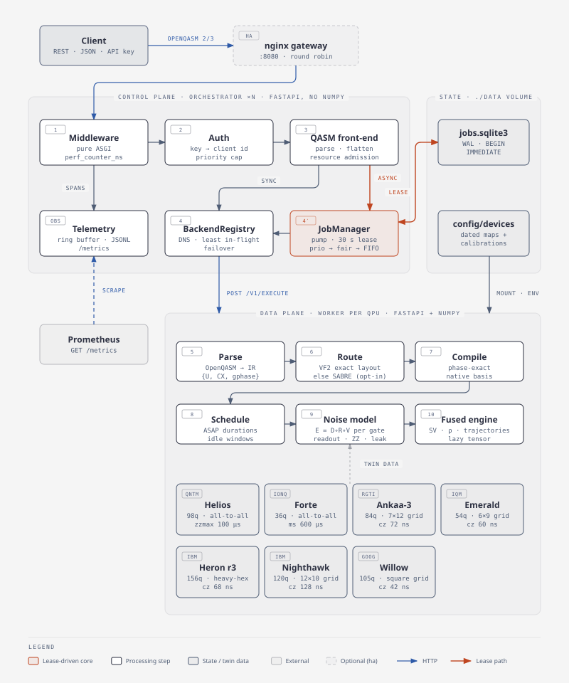
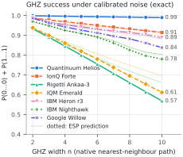

<div class="qt-hero" markdown>

# QPUTwin: Calibration-Faithful Digital Twins of Trapped-Ion and Superconducting Quantum Processors

<p class="lead">QPUTwin is an open-source quantum digital twin and QPU emulator. It reproduces seven real quantum processors (Quantinuum Helios, IonQ Forte, Rigetti Ankaa-3, IQM Emerald, IBM Heron r3, IBM Nighthawk and Google Willow), with their native gates, qubit connectivity, calibrated noise and gate timing, behind one OpenQASM API.</p>

[Get started](getting-started/index.md){ .md-button .md-button--primary }
[Quick start](getting-started/quickstart.md){ .md-button }
[Benchmark results](research/benchmarks.md){ .md-button }

*Koustav Kumar Mondal · erkoustavkumar@gmail.com*

</div>

<div class="qt-kpi" markdown>
<div><b>7</b><span>quantum processors twinned: 2 trapped-ion, 5 superconducting</span></div>
<div><b>3</b><span>simulation engines: statevector, density matrix, quantum trajectories</span></div>
<div><b>616 + 47</b><span>unit and live-stack tests, all passing</span></div>
<div><b>0</b><span>vendor SDKs: everything below HTTP is written from scratch in numpy / scipy</span></div>
</div>

## What you can do with QPUTwin

<div class="qt-grid" markdown>
<div class="qt-card" markdown>
### :material-chip: Run on seven QPUs side by side
Submit one OpenQASM circuit and run it on all-to-all trapped-ion and square-lattice superconducting twins, with identical semantics. [Devices →](concepts/devices.md)
</div>
<div class="qt-card" markdown>
### :material-sine-wave: Calibration-faithful noise
Every gate reproduces its **published fidelity exactly**, together with T1/T2, crosstalk, leakage, quasi-static drift and readout error. [Noise →](guide/noise.md)
</div>
<div class="qt-card" markdown>
### :material-graph-outline: Enforce or route topology
Topology violations are rejected exactly as a vendor compiler would reject them, or routed with SABRE so the cost can be measured. [Routing →](guide/routing.md)
</div>
<div class="qt-card" markdown>
### :material-timer-outline: Exact latency telemetry
Every response decomposes its round trip into additive spans, which is ready-made data for quantum-cloud benchmarking papers. [Telemetry →](guide/telemetry.md)
</div>
<div class="qt-card" markdown>
### :material-clock-fast: Hardware time estimates
An ASAP schedule from calibrated gate durations estimates the wall-clock time per shot and per job on the real device. [Timing →](guide/timing.md)
</div>
<div class="qt-card" markdown>
### :material-server-network: Production deployment
Asynchronous jobs on a durable shared queue, worker replicas, API keys, Prometheus metrics and an HA gateway. [Operations →](operations/index.md)
</div>
</div>

## Architecture at a glance

{ .qt-diagram }

## Results at a glance

<figure markdown>

<figcaption>GHZ-state success probability under each device's calibrated noise model, simulated exactly with the density-matrix engine. The trapped-ion twins keep high fidelity as width grows; the superconducting twins are dominated by readout error. More in <a href="research/benchmarks/">Benchmark results</a>.</figcaption>
</figure>

## A first job

```bash
docker compose up -d --build
curl -s localhost:8000/v1/jobs -H 'content-type: application/json' -d '{
  "backend": "iqm_emerald",
  "qasm": "OPENQASM 2.0;\ninclude \"qelib1.inc\";\nqreg q[2];\ncreg c[2];\nh q[0];\ncx q[0],q[1];\nmeasure q -> c;",
  "shots": 1000, "seed": 7,
  "options": {"noise": {"model": "device"}}
}'
```

The response carries the counts, the compilation report (native gates, depth, hardware time estimate), the noise report (which calibration values were used and where they come from), and the telemetry decomposition. See [Quick start](getting-started/quickstart.md).

!!! info "Research honesty"
    Every calibration number is tagged `published` (with its source) or `assumed`, and every noisy result lists the values it relied on. A strict mode refuses to run on unpublished values. See [Calibration data](guide/calibration.md).
