# Benchmark results

All figures are produced by `benchmarks/run_benchmarks.py` (data) and `benchmarks/plot_figures.py` (figures). Vector PDF and SVG versions, 300-dpi PNGs, the raw JSON results and a CSV of every plotted value are in `benchmarks/`.

!!! info "Setup"
    | Item | Value |
    |---|---|
    | CPU | AMD EPYC 9474F, 16 vCPUs, 62 GB (one cloud virtual machine runs the clients and the stack) |
    | Software | QPUTwin 0.1.0, Python 3.13, numpy 2.5.4, Docker 29.9 |
    | Configuration | `OMP_NUM_THREADS=1`; each worker limited to 4 CPUs / 12 GiB, its engine using all 4 |
    | Host load during the run | load average ≈ 1–2.5 before each run; seven worker containers running |
    | Date | 2026-11-10 |
    | Methods | live experiments go through the full HTTP stack; in-process experiments call the same simulator classes directly |

    Absolute times depend on the host; ratios and trends are the transferable results. **Calibration values tagged `assumed`** (mainly the gate durations and the readout fidelity of the four median-based twins; the IBM and Google twins use the vendors' published snapshots) affect the noise and timing results; see [Emulated devices](../concepts/devices.md#calibration-at-a-glance).

!!! tip "More benchmarks"
    * [Circuit-family benchmarks](circuit-benchmarks.md): nine circuit families on all seven QPUs, a QV-style heavy-output test and routing overhead by algorithm.
    * [Load & stress testing](load-testing.md): up to 256 concurrent clients, queueing-theory checks, a five-minute soak, a 3 500-job async burst, fair share and scale-out.

## Latency decomposition

<figure markdown>
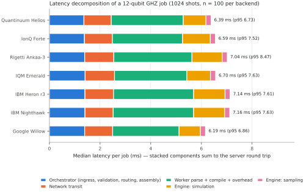
<figcaption>Median server round trip of a 12-qubit GHZ job (1024 shots, 100 jobs per backend, live stack), decomposed into additive telemetry spans.</figcaption>
</figure>

| Backend | Median | p95 | Orchestrator | Network | Worker parse + compile | Engine |
|---|---|---|---|---|---|---|
| Quantinuum Helios | 6.39 ms | 6.73 ms | 1.36 | 1.08 | 2.84 | 1.10 |
| IonQ Forte | 6.59 ms | 7.52 ms | 1.38 | 1.10 | 2.77 | 1.30 |
| Rigetti Ankaa-3 | 7.04 ms | 8.47 ms | 1.39 | 1.15 | 3.09 | 1.39 |
| IQM Emerald | 6.70 ms | 7.63 ms | 1.41 | 1.16 | 2.86 | 1.14 |
| IBM Heron r3 | 7.14 ms | 7.61 ms | 1.40 | 1.13 | 3.16 | 1.44 |
| IBM Nighthawk | 7.16 ms | 7.63 ms | 1.40 | 1.11 | 3.17 | 1.43 |
| Google Willow | 6.19 ms | 6.86 ms | 1.39 | 1.11 | 2.62 | 1.04 |

**Finding.** For small circuits the engine is only 17–20% of the round trip. Parsing, compilation and overhead in the worker (42–45%) and the orchestration path (35–41%: validation, routing, network) dominate. The emulation layer is therefore the bottleneck for small jobs, which matters when interpreting quantum-cloud latency studies.

<figure markdown>
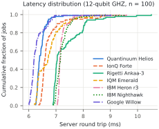{ width="520" }
<figcaption>Empirical CDF of the round trip. The distributions are tight (p90 ≈ 1.04–1.14 × median, p99 ≈ 1.11–1.42 ×); the slowest of 700 jobs took 10.5 ms.</figcaption>
</figure>

## Engine scaling

<figure markdown>
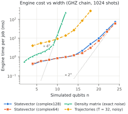{ width="520" }
<figcaption>Engine time per job versus simulated width (GHZ chain, 1024 shots, median of 3 runs, in-process, one engine thread). Dotted guides: 2ⁿ and 4ⁿ.</figcaption>
</figure>

| Engine | Largest width tested | Time (1 thread) |
|---|---|---|
| Statevector, complex128 | 24 qubits | 73 ms |
| Statevector, complex64 | 24 qubits | 61 ms |
| Density matrix (exact noise) | 12 qubits | 0.23 s |
| Trajectories (T = 32, noisy) | 18 qubits | 0.28 s |

**Finding.** The statevector grows roughly as $2^n$ above ~18 qubits (below that, fixed per-job overhead dominates). The density matrix grows as $4^n$. Both exact engines use [fused execution](../guide/engines.md#fused-execution). The GHZ chain is the best case, because lazy activation keeps the state small until the last block. A deep random circuit is still dense work: a 24-qubit QV-style circuit takes 8.7 s on one thread (2.8× faster than Qiskit Aer, 3.5× slower than qsim; see the [simulator comparison](simulator-comparison.md)). The trajectory engine runs [batched and fused](../guide/engines.md#batched-fused-trajectories). `engine: auto` uses the density matrix while $2^n \le 4T$ (up to 12 qubits for 1024 shots) and trajectories above. See the [simulator comparison](simulator-comparison.md) for how these speeds rank against Qiskit Aer, qsim, Qulacs, Braket and Cirq.

## Cost of routing

<figure markdown>
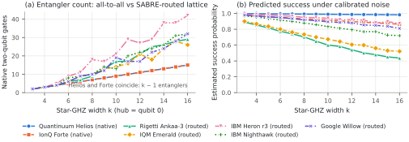
<figcaption>(a) Native entanglers for a star-GHZ state: k − 1 on the all-to-all twins (the Helios and Forte curves coincide), SABRE-routed on the five lattices. (b) Estimated success probability under calibrated noise.</figcaption>
</figure>

Native entanglers (SWAPs) and estimated success probability (ESP):

| k | Helios / Forte | Ankaa-3 | Emerald | Heron r3 | Nighthawk | Willow |
|---|---|---|---|---|---|---|
| 8 | 7 · 0.991 / 0.932 | 9 (2) · 0.702 | 10 (1) · 0.735 | 18 (5) · 0.950 | 10 (1) · 0.879 | 10 (1) · 0.918 |
| 12 | 11 · 0.987 / 0.897 | 21 (4) · 0.540 | 21 (4) · 0.606 | 27 (8) · 0.922 | 22 (5) · 0.794 | 17 (4) · 0.880 |
| 16 | 15 · 0.982 / 0.864 | 29 (6) · 0.436 | 26 (5) · 0.521 | 42 (13) · 0.873 | 32 (7) · 0.719 | 32 (7) · 0.811 |

<figure markdown>
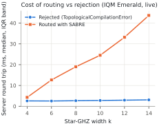{ width="520" }
<figcaption>Live round trip on IQM Emerald: rejected without routing versus routed with SABRE (median, IQR band, 15 jobs per point).</figcaption>
</figure>

**Finding.** Rejection is cheap and nearly constant (2.5–3.1 ms). A star with more leaves than any physical qubit has neighbours cannot be embedded, so SABRE routes it. With 16 layout trials scored by the emitted circuit, routing costs 0.5–34.5 ms of router time and up to 44 ms of round trip at k = 14, and it inflates the entangler count 1.7–2.1× at k = 16 on the square lattices and 2.8× on Heron's heavy-hex lattice, where no qubit has more than three neighbours. The fidelity price is the larger one: the predicted success at k = 16 falls to 0.44–0.87 on the lattices, against 0.86–0.98 on the all-to-all twins. On the twins with per-qubit data the [calibration-aware re-layout](../guide/routing.md#calibration-aware-re-layout) keeps the routed star on well-calibrated qubits, so Heron, despite the most entanglers, keeps the highest predicted success of the lattices (0.87, against 0.81 on Willow and 0.72 on Nighthawk). The commutation-aware cancellation pass removed up to 12 entanglers per instance with k ≥ 6.

!!! note "Fewer SWAPs for more router time"
    The router runs 16 SABRE trials on circuits of this size and keeps the one whose emitted circuit, after cancellation, has the fewest two-qubit gates. Its 0.5–34.5 ms of router time is still small next to the round trip. Set `routing.trials` to trade router time against entanglers.

## GHZ fidelity

<figure markdown>
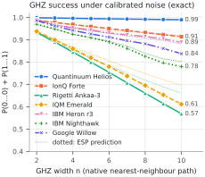{ width="520" }
<figcaption>GHZ success P(0…0) + P(1…1) under each device's calibrated noise (density matrix, exact; 100 000 shots). Dotted: the estimated success probability (ESP).</figcaption>
</figure>

| n | Helios | Forte | Ankaa-3 | Emerald | Heron r3 | Nighthawk | Willow |
|---|---|---|---|---|---|---|---|
| 2 | 0.999 | 0.987 | 0.934 | 0.938 | 0.990 | 0.970 | 0.986 |
| 6 | 0.994 | 0.950 | 0.754 | 0.780 | 0.931 | 0.891 | 0.912 |
| 10 | 0.990 | 0.914 | 0.569 | 0.612 | 0.889 | 0.780 | 0.838 |

**Finding.** The ESP (a product of gate and readout fidelities) is accurate for the trapped-ion twins but **overestimates** every superconducting one at n = 10: 0.661 vs 0.569 (Ankaa-3), 0.696 vs 0.612 (Emerald), 0.919 vs 0.889 (Heron), 0.803 vs 0.780 (Nighthawk) and 0.881 vs 0.838 (Willow). The ESP ignores idle decoherence and the T1 decay of the $|1\dots1\rangle$ branch during the aligned read-out, both of which the exact simulation includes.

## Error budget

<figure markdown>
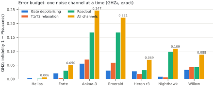
<figcaption>GHZ₆ infidelity with one noise channel at a time (density matrix, 200 000 shots).</figcaption>
</figure>

**Finding.**

* **Ankaa-3 and Emerald:** readout dominates (0.168), ahead of T1/T2 relaxation (0.059–0.070) and gate depolarisation (0.030–0.055). Their readout fidelity is an *assumed* typical value (97 %), so replacing it with a measured snapshot changes the leading term.
* **Nighthawk:** readout dominates too (0.098 of 0.109), from the published 1.8 % median readout error.
* **Heron r3:** the lowest superconducting total (0.069), split evenly between gates (0.028), readout (0.032) and relaxation (0.018).
* **Willow:** relaxation (0.043) is as large as readout (0.043): its T1 of 70 µs is a quarter of the IBM chips' 290–330 µs.
* **Forte:** SPAM (0.030) and gates (0.021) matter.
* **Helios:** total error is only 0.006, and T1/T2 are not modelled for its hyperfine qubits.

## Hardware time

<figure markdown>
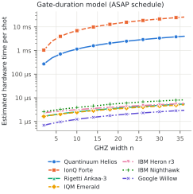{ width="520" }
<figcaption>Estimated hardware time per shot from the ASAP gate-duration model (GHZ along a native path). Log scale.</figcaption>
</figure>

| n | Helios | Forte | Ankaa-3 | Emerald | Heron r3 | Nighthawk | Willow |
|---|---|---|---|---|---|---|---|
| 2 | 0.27 ms | 1.04 ms | 1.65 µs | 1.64 µs | 2.33 µs | 2.59 µs | 0.69 µs |
| 12 | 1.37 ms | 8.39 ms | 2.77 µs | 2.64 µs | 3.35 µs | 4.21 µs | 1.36 µs |
| 36 | 4.01 ms | 26.0 ms | 5.46 µs | 5.04 µs | 5.75 µs | 8.19 µs | 2.97 µs |

**Finding.** Superconducting shots take microseconds, trapped-ion shots milliseconds: a gap of **three orders of magnitude**. Willow's shots are the shortest, because its read-out takes 600 ns against 1.5–2.4 µs on the others. Forte is slower than Helios because of its (assumed, Aria-derived) gate times and serial entangling gates. The durations of the IBM and Google twins are published; for the four median-based twins most are `assumed`, so treat those as order-of-magnitude estimates. The per-shot circuit time excludes per-shot overhead; the job estimate of the IBM twins adds IBM's published repetition delay (250 µs on Heron, 4 ms on Nighthawk), which dominates a job.

## Noise sensitivity

<figure markdown>
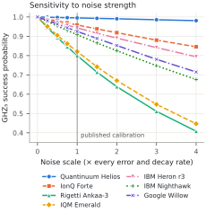{ width="520" }
<figcaption>GHZ₅ success versus a global noise scale (× every error and decay rate; 1 = published calibration).</figcaption>
</figure>

**Finding.** At scale 1, GHZ₅ success is 0.995 (Helios), 0.959 (Forte), 0.943 (Heron r3), 0.925 (Willow), 0.908 (Nighthawk), 0.821 (Emerald) and 0.800 (Ankaa-3). At scale 4 it falls to 0.981, 0.845, 0.794, 0.715, 0.676, 0.447 and 0.408. The superconducting twins sit in a far steeper part of the curve, so a 2× improvement in their error rates moves success much more than the same improvement on the ions.

## Trajectory convergence

<figure markdown>
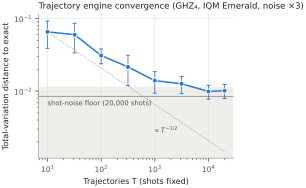{ width="520" }
<figcaption>Total-variation distance between trajectory results and the exact density-matrix distribution (GHZ₄ on Emerald at noise × 3, 20 000 shots, 5 seeds). Grey band: shot-noise floor (mean and 95th percentile).</figcaption>
</figure>

**Finding.** The error falls from 0.066 (T = 10) to 0.014 (T = 1000), roughly as $T^{-1/2}$, and reaches the 20 000-shot noise floor (mean 0.0085, 95th percentile 0.0115) by T ≈ 10 000. With trajectories = shots (the default), sampling is exact: at T = 20 000 the distance is 0.010, inside the floor's band.

## Horizontal scaling

<figure markdown>
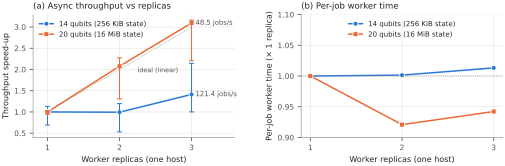
<figcaption>(a) Asynchronous throughput speed-up versus worker replicas on one host (IonQ Forte, star GHZ, 64 shots, submitted by 16 concurrent clients; median and range of five runs of 480 or 120 jobs). (b) Median per-job worker time relative to one replica.</figcaption>
</figure>

| Workload | 1 replica | 2 replicas | 3 replicas | Worker time per job |
|---|---|---|---|---|
| 14 qubits (256 KiB) | 86 jobs/s | 85 (0.99×) | 121 (1.41×) | 4.2 → 4.2 → 4.3 ms |
| 20 qubits (16 MiB) | 15.7 jobs/s | 32.6 (2.08×) | 48.5 (3.10×) | 55 → 51 → 52 ms |

**Finding.** Two different limits appear:

* **20-qubit jobs** are worker-bound and scale linearly: 2.08× with two replicas and 3.10× with three. Per-job worker time does not grow (55 → 51 → 52 ms); the single-replica runs were the slowest per job, which is why the speed-up slightly exceeds the replica count. The fused engine reads and writes the state once per block, so three replicas do not saturate the host's memory bandwidth.
* **14-qubit jobs** finish in about 4 ms of worker time, so the single orchestrator's asynchronous dispatch path (accepting, claiming and recording every job) carries most of each job. They do not scale with two replicas (0.99×) and reach 1.41× with three, and their throughput varies by 2–4× between runs (59–97 jobs/s with one replica, 46–103 with two, 86–184 with three). More orchestrators lift that ceiling (see [load testing](load-testing.md#orchestrator-scale-out)).

!!! note "Method"
    Each point is the median of five runs of 120 (20 qubits) or 480 (14 qubits) jobs submitted by 16 concurrent clients, so the measurement reflects the workers rather than the client's submission rate; the figure shows the range.

## Non-Markovian dephasing

<figure markdown>
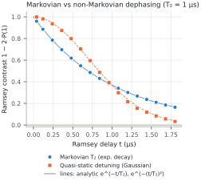{ width="520" }
<figcaption>Ramsey contrast on IQM Emerald: Markovian T₂ (density matrix, 200 000 shots) versus quasi-static detuning with σ = 225 kHz (trajectories, 4000 shots, exact sampling), chosen to give the same 1/e time T₂ = 1 µs. Lines: analytic e^(−t/T₂) and e^(−(t/T₂)²).</figcaption>
</figure>

**Finding.** Both models match their analytic curves. The quasi-static model preserves coherence longer at short delays and loses it faster afterwards (Gaussian decay). A per-window Markovian channel cannot reproduce this, which is why the term is trajectory-only.

## Reproduce

```bash
docker compose up -d --wait
uv run --group bench python benchmarks/run_benchmarks.py all     # ~75 min incl. load tests; restarts workers for scaling runs
uv run --group bench python benchmarks/plot_figures.py
```
