# Load & stress testing

This page drives the live Docker stack hard and measures how throughput, latency and isolation behave. Every request goes through the full HTTP path: client → (gateway) → orchestrator → worker → engine.

!!! info "Setup"
    | Item | Value |
    |---|---|
    | Host | One VM, 16 vCPUs of an AMD EPYC 9474F, 62 GB RAM; it runs the clients and the whole stack (7 workers + orchestrator) |
    | Stack | 1 orchestrator, 1 worker per QPU (4 CPUs / 12 GiB each, four engine threads), `QPUTWIN_WORKER_CONCURRENCY=1` (one job at a time, like a QPU) |
    | Light job | GHZ₈, 256 shots: the engine needs under 1 ms, so the job measures the *system*, not the physics |
    | Heavy job | QV-style, 12 qubits, 1024 shots, IonQ Forte: ≈ 96 ms of worker time per job |
    | Load generator | `httpx` + `asyncio`; 3 client processes for the scale-out runs |
    | Latency | measured **at the client** unless stated otherwise (see [Where the queue lives](#where-the-queue-lives)) |
    | Data | `benchmarks/results/{load_closed,load_ha,load_open,soak,async_burst,fairshare,shots,gate_scaling,saturation}.json` |

    Reproduce with `uv run --group bench python benchmarks/run_benchmarks.py load_closed load_ha load_open soak async_burst fairshare shots gate_scaling`, which takes about 30 minutes and restarts the stack with different replica counts.

## Summary

| Test | Result |
|---|---|
| Peak sync throughput, one worker, light jobs | **289 jobs/s** at 4–16 clients (client p50 14 ms at 4) |
| Peak sync throughput, seven QPUs, 1 orchestrator | **374–378 jobs/s**; the orchestrator is the bottleneck |
| … with 3 orchestrators behind nginx | **917 jobs/s** (2.6× one orchestrator behind nginx) |
| Heavy jobs, 1 → 4 worker replicas | 10.2 → **25.2 jobs/s** (2.5×) |
| Five-minute soak, 120 jobs/s | **36 155 jobs, 0 errors**, client p50 8.1 ms / p99 18.5 ms, memory flat after warm-up |
| Async burst | **3 500 jobs accepted in 9.7 s** (362/s), all completed within 16.8 s |
| Fair share vs a flooding client | light client's median wait **1 519 ms → 3.6 ms** |
| Little's law, N = X·R | median deviation 0.25 %, worst 14.8 % (over 59 load levels) |
| Whole host saturated (21 worker replicas, 16 vCPUs at 100 %) | **90 326 light + 5 756 heavy jobs, 0 errors**, 66 oversized jobs refused, 0 OOM kills |
| Errors across all load tests | **0** (no 5xx, no timeouts, no lost jobs) |

## Closed loop: throughput and latency vs concurrency

Each of *N* clients sends its next job as soon as the previous one returns.

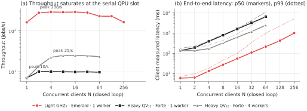

* **One worker saturates at its serial slot.** Light jobs reach 289 jobs/s from *N* = 4–16, so a worker spends about 3.5 ms per job: HTTP, JSON, parse and compile. The emulated QPU time is only 0.8 ms. Heavy jobs saturate at 10.2 jobs/s from *N* = 2. Their worker time (about 97 ms) is parsing (33 ms), native compilation (32 ms) and the engine (30 ms) of a 1 400-gate circuit; the orchestrator's validation adds another 38 ms before dispatch.
* **Past saturation, latency grows linearly in *N*** while throughput stays flat, which is the closed-loop signature of a single queue. For heavy jobs: 136 ms at *N* = 1, 6.4 s at *N* = 64.
* **Light-job throughput sags at high concurrency** (289 → 163 jobs/s at 256 clients). Every waiting request still costs the single-process Python services some event-loop time, so heavy oversubscription has a real overhead. Keep the concurrency per worker near its knee (about 8), or use the [asynchronous queue](../guide/async-jobs.md), which never sends a worker more than its capacity.
* **Four worker replicas give 2.5× heavy throughput** (10.2 → 25.2 jobs/s) rather than 4×. The engine time per job does not grow (30 ms at 16 clients); the loss is outside the engine. Four replicas with four engine threads each fill the host's 16 vCPUs, which the orchestrator and the clients also use, and at 16 clients the orchestrator's ingress and the dispatch transit grow to 131 and 250 ms per job. Linear scale-out needs dedicated hosts or cores per replica.

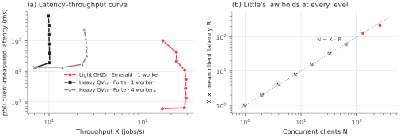

The latency–throughput curves show the classic "hockey stick": throughput stops rising while latency keeps climbing. Panel (b) checks **Little's law** $N = X \cdot R$, using the measured throughput $X$ and mean client latency $R$. Over all 59 closed-loop levels (the 23 single-QPU levels are plotted, plus the mixed and scale-out runs) it holds with a median deviation of 0.25 %. The worst case is 14.8 %, for light jobs on one QPU at 256 clients (32× its knee), the most oversubscribed level. That confirms no requests were lost or double-counted.

## Where the queue lives

The telemetry's additive breakdown shows *where* a job waits as load rises:

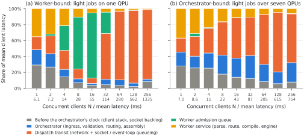

* **(a) Worker-bound:** light jobs on one QPU. Up to about 32 clients the wait is mostly in the worker's **admission queue** (`worker_queue_ms`, green; 65 % of the latency at 8 clients, 82 % at 16, 27 % at 32), exactly where it should be. Beyond that, requests wait *before* the worker's handler starts: in its socket backlog and in the orchestrator's event loop. The telemetry reports this as **dispatch transit** (orange): 86 % of the latency at 64 clients.
* **(b) Orchestrator-bound:** light jobs over seven QPUs. The seven workers have spare capacity, and the queue builds in the orchestrator's dispatch path: dispatch transit rises from 18 % of the latency at one client to 51 % at 16 and 75 % at 128.

!!! warning "Server-side telemetry cannot see every queue"
    The orchestrator's clock starts when its middleware receives a request. Time a request spends in the kernel's accept queue, or waiting for a busy event loop, appears either as `network_transit_ms` or not at all in `total_roundtrip_ms`. Under overload, measure latency **at the client** as well. In the mixed run over seven QPUs at 256 clients, the server-side p50 read 42 ms while the client-side p50 was 1.5 s. The [saturation test](#the-whole-host-saturated) shows the same gap. The [limitations](limitations.md) page lists this.

## Orchestrator scale-out

The orchestrator is a single Python process, so with fast jobs spread over many QPUs it becomes the ceiling. Replicas behind the nginx gateway lift it:

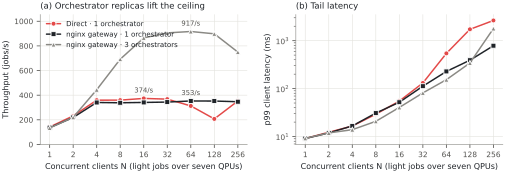

| Setup | Peak throughput | p99 at 32 clients | p99 at 256 clients |
|---|---|---|---|
| Direct, 1 orchestrator | 374 jobs/s | 131 ms | 2 637 ms |
| nginx gateway, 1 orchestrator | 353 jobs/s | 112 ms | **785 ms** |
| nginx gateway, 3 orchestrators | **917 jobs/s** | **81 ms** | 1 791 ms |

(p99 measured at the client.)

* Three orchestrators give **2.5× the direct peak** and 2.6× one orchestrator behind the gateway, not 3×: the 16 vCPUs are shared by 3 orchestrators, 7 workers, nginx and 3 client processes. From 32 to 128 clients the three-orchestrator setup holds 898–917 jobs/s; at 256 clients it drops to 750 jobs/s with a 1.8 s p99, when the client processes (0.64 core each) and nginx compete with it for the host.
* nginx costs about 5 % of peak throughput but **keeps a single overloaded orchestrator stable**: throughput holds at 341–353 jobs/s from 16 to 256 clients, while direct connections dip to 208 jobs/s with a 1.7 s client p99 at 128 clients (against 391 ms through nginx). nginx absorbs connection churn the Python event loop handles poorly.

## Open loop: queueing theory check

Jobs arrive as a Poisson process at rate λ, independent of completions. A single worker with a nearly constant service time (E[S] = 97 ms, coefficient of variation 0.06) should then behave like an **M/G/1 queue**. The Pollaczek–Khinchine formula predicts the mean response time:

$$
\bar R = R_0 + \frac{\lambda\,\mathbb{E}[S^2]}{2\,(1-\rho)}, \qquad \rho = \lambda\,\mathbb{E}[S],
$$

where $R_0$ is the unloaded round trip.

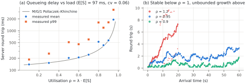

* **(a)** The measured mean follows the prediction within 0.1–1.7 % at ρ = 0.1, 0.3, 0.6, 0.7 and 0.9 (for example ρ = 0.7: 246.9 ms measured, 247.1 ms predicted), within 5 % at ρ = 0.85 and within 12 % at ρ = 0.5. Near saturation, individual windows can scatter far from the curve: +60 % at ρ = 0.8 (524 vs 328 ms) and +82 % at ρ = 0.95 (1.92 vs 1.06 s). That is expected, because the relaxation time of an M/G/1 queue grows as $(1-\rho)^{-2}$, and a finite window samples only a few of its long busy periods.
* **(b)** Below ρ = 1 the response time fluctuates around a stable level. At ρ = 1.2 it grows without bound, by about 0.32 s per second of overload. Plan capacity for **ρ ≲ 0.7** if you need a bounded p99.

## Soak: five minutes of sustained load

The soak test sends 120 jobs/s as Poisson arrivals over all seven QPUs (36 155 jobs) and records `docker stats` every 5 s:

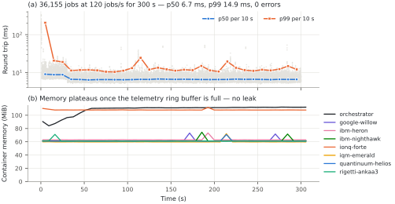

* **No errors**, and no drift: the server p50 stays between 6.4 and 9.0 ms in every 10-s window (6.7 ms overall; p99 14.9 ms). Only the first window has a higher p99 (207 ms, against at most 24.4 ms afterwards), from cold connections and caches.
* **Memory plateaus.** The freshly started orchestrator grows from 84–91 to 110 MiB during the first ~60 s, while its 10 000-record telemetry ring buffer fills (`QPUTWIN_TELEMETRY_BUFFER`). It then stays at 110–112 MiB for the remaining four minutes. The workers stay flat (60–74 MiB; Forte 108–112 MiB), so there is no leak in the request path, the ring buffer or the JSONL writer.

## Asynchronous burst

3 500 async jobs (500 per QPU) are submitted by 16 concurrent clients:

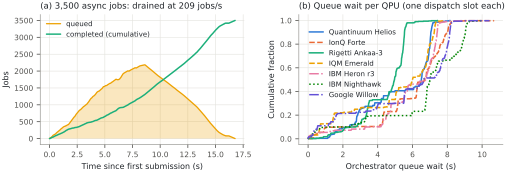

* **Admission is fast:** 362 jobs/s accepted (p50 7.8 ms per `202` at 16 concurrent submitters), and the queue peaked at 2 188 jobs.
* **Draining** runs at 209 jobs/s on average over seven one-slot QPUs, and at 269 jobs/s once submissions stop, because the same orchestrator both accepts and dispatches.
* All 3 500 jobs completed within 16.8 s. The QPUs' median queue waits range from 5.0 s (Ankaa-3) to 7.0 s (Nighthawk): every QPU drains its 500 jobs through one slot, and the shared orchestrator interleaves them.

## Fair-share isolation

A "heavy" client floods IonQ Forte with 300 jobs (star GHZ₁₄, 64 shots) as one burst. A "light" client then submits 20 jobs, 100 ms apart.

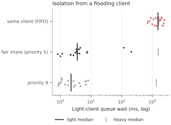

| Light client | Median wait | Max wait |
|---|---|---|
| Same client name as the flood (plain FIFO) | 1 519 ms | 2.45 s |
| Own name, priority 5 (**fair share**) | **3.6 ms** | 204 ms |
| Own name, priority 9 | 2.2 ms | 8.1 ms |

Fair share alternates the single dispatch slot between active clients (least-recently-served first), so the light client waits for at most the job in progress, not for the whole backlog. Under FIFO it waits behind everything the flood queued first. The fair-share maximum (204 ms) comes from a short pause in which no job of either client completed. The order stayed fair; we did not isolate the cause of the pause.

!!! note "How fair share orders clients"
    With one dispatch slot per QPU, every client's running-job count is zero whenever the slot frees, so the scheduler breaks the tie by *least recently served*. That gives round-robin between clients, verified by `test_fair_share_round_robin_with_one_slot` for both job stores. The "last served" order is kept in a small `client_usage` table updated once per claim, so the ordering is a primary-key lookup.

!!! note "Retention does not slow submissions"
    Retention uses partial indexes over finished jobs, trims only when over the limit, and runs at most every 2 s on the submission path, so accepting a job does not depend on how many jobs are stored (`test_submissions_do_not_prune_every_time`, `test_retention_keeps_the_newest_finished_jobs`). In the async burst above, admission ran at a median 7.8 ms per `202` with 16 concurrent submitters.

## Shots and circuit size

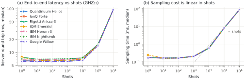

* Up to 10⁴ shots the round trip is flat at about 7 ms; sampling costs 0.17 ms at one shot and 0.6 ms at 10⁴.
* Sampling then grows **linearly**, at about 86 ns per shot (86 ms for 10⁶ shots, 93–96 ms for the whole job), and dominates the job. The response stays at about 3.1 kB because only the counts are returned.

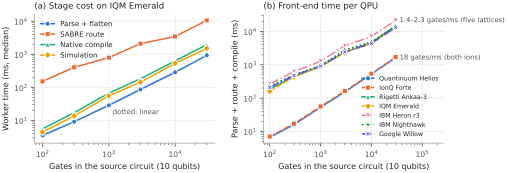

* **Parsing is linear** at about 31–33 gates/ms. A 30 000-gate (300 kB) circuit takes 0.91–0.96 s to parse in the worker. The orchestrator's validation parses it **again**, which doubles the front-end cost for very large circuits.
* **SABRE routing** dominates on the lattices: 10.6–11.4 s for 30 000 gates on the square lattices (Emerald, Willow, Ankaa-3, Nighthawk) and 15.9 s on Heron's sparser heavy-hex lattice, 1.9–2.8 gates/ms for the router alone. The automatic trial count steps down with size (16 / 8 / 4 / 2), so routing time grows sub-linearly between 3 000 and 10 000 gates (2.1 → 3.5 s on Emerald) and linearly beyond.
* **Native compilation** runs at 38–42 gates/ms on the ions, 12–18 gates/ms on the square lattices and 6.3 gates/ms on Heron, whose routed circuits are the longest.

!!! note "Linear scheduling on devices with a parallelism limit"
    The ASAP gate-duration scheduler prunes booked intervals that end before the earliest qubit clock, so its cost stays linear on IonQ Forte, which limits parallel gates: Forte compiles 30 000 gates in 0.76–0.79 s on the server, with a schedule bit-for-bit identical to the unpruned one (`test_interval_pruning_keeps_the_schedule_identical`).

## The whole host saturated

The tests above load one part of the stack at a time. This one (E22) loads **everything at once** for ten minutes: three replicas of every twin (21 workers, each limited to 7 GiB and allowed all 16 vCPUs), one orchestrator, and four job classes in parallel:

* **light**: Poisson GHZ₈ jobs at 150 jobs/s over all twins, synchronous;
* **heavy, memory**: two async streams per twin of a 28-qubit, 12-layer brickwork circuit (a 4 GiB complex128 state; with the per-worker memory left, the guard runs the fused executor in place);
* **heavy, compute**: two async streams per twin of an 11-qubit noisy density matrix, or a 22-qubit QV-style circuit on the all-to-all twins;
* **oversized**: a 30-qubit job every 5 s, which no worker can hold.

Host CPU and memory are sampled every second, and `docker stats` and the containers' OOM and restart counters are polled.

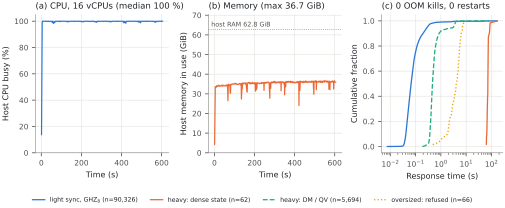

| Result | Value |
|---|---|
| Host CPU | **100 %** (median over 600 s) of 16 vCPUs |
| Host memory | 32–37 GiB in use (36.7 GiB peak of 62.8 GiB) |
| Light jobs | **90 326 / 90 326** completed; server p50 67 ms, p99 0.90 s |
| Heavy jobs | **5 756 / 5 756** completed: 62 dense 28-qubit statevectors (all in place, median 72 s each) and 5 694 density-matrix / QV jobs |
| Oversized jobs | **66 / 66** refused with `422 ResourceLimitError` |
| OOM kills, container restarts, 5xx | **0, 0, 0** |

* **The service degrades, it does not fail.** With every core busy, light jobs still complete, all of them, and the server-side median stays at 56–85 ms in every minute of the run: there is no backlog.
* **The memory guard holds.** A 28-qubit statevector needs 2 × 4 GiB with two buffers, more than a 7 GiB worker has left; the guard switched each of these jobs to the single-buffer executor (peak 1.5 × state) instead of refusing it, and refused every 30-qubit job. No worker was killed for memory.
* **A refusal waits its turn.** An oversized job is refused only when it reaches a worker's single slot, so the 422 arrives after 0.5–10 s, behind the heavy job in progress.
* **Client-side latency is not the service's.** The single `asyncio` load generator runs on the same saturated host as the 21 workers, so its own latency (client p50 4.9 s) includes waiting for CPU time. The server-side spans, which stay flat, are the service's latency here; when the host is not saturated the two agree within about 1.5 ms (soak test: server p50 6.7 ms, client 8.1 ms).

!!! note "Not a memory-exhaustion test"
    Memory peaked at 37 of 62.8 GiB, not at the host limit. Concurrent jobs are bounded by the per-worker guard, which deliberately keeps headroom: the twins never compete for the last gigabytes. How large a *single* job can go on this host, up to the RAM limit, is measured separately by the [capacity sweep](simulator-comparison.md#how-wide-each-simulator-goes).

## Recommendations

1. **Size workers by service time, not job count.** A worker's capacity is 1 / (worker time per job). Watch `qputwin_replica_in_flight` and keep the concurrency per worker near the knee of the throughput curve.
2. **Prefer the asynchronous queue under bursty load.** It bounds in-flight work per worker and gives fair share and priorities. The synchronous path has neither.
3. **Run 2–3 orchestrators behind the gateway** once fast jobs exceed about 300 jobs/s, and give replicas dedicated cores.
4. **Measure latency at the client** when you load-test; server telemetry is exact for what it sees but blind to accept-queue time.
5. **Route very large circuits once.** For 10⁴+ gates, SABRE time dominates. Submit pre-routed native circuits, or reduce SABRE trials, if routing cost matters.
