# Simulator comparison

A comparative benchmark of **QPUTwin** against **Qiskit Aer**, the **Amazon Braket local simulators**, **Cirq**, **qsim** and **Qulacs**:

1. **Correctness:** do they produce the same ideal output distributions?
2. **Speed:** ideal statevector and noisy density-matrix run time vs width, at equal thread budgets of 1, 4 and 16 threads.
3. **Capacity:** the widest job each simulator completes on the whole host, and how it fails beyond.
4. **Noise-model cross-validation:** does an *independently written* Qiskit Aer model, fed the identical calibration, reproduce QPUTwin's noisy results, and where does QPUTwin differ?
5. **The vendors' own noise models:** do the IBM and Google twins reproduce the noise models IBM and Google ship for the same calibration snapshots?
6. **The vendors' own workflows, end to end:** time, throughput and prediction of a QPUTwin job against IBM's and Google's own emulation pipelines.
7. **Compilation:** how QPUTwin's router and native compiler compare with the Qiskit transpiler.

QPUTwin is measured on the **running Docker stack** (`http://localhost:8000`). The scripts only send HTTP requests to it; they never start, stop or reconfigure it. Single-thread timings of QPUTwin's engine use the identical code in-process.

## What makes QPUTwin fast

* **Fused, multithreaded execution.**
  * Native gates are fused into dense blocks of up to 5 qubits and applied with one matrix product per block, on a lazily permuted tensor.
  * A block that needs its qubits moved is applied *while* gathering cache-sized chunks, so the state is read and written only once.
  * Noise channels, depolarisation and resets become superoperators and fuse with the gates around them in the density-matrix engine.
  * Trailing diagonal gates that cannot affect the measurement are skipped.
  * Work is split across the worker's CPU quota (`QPUTWIN_ENGINE_THREADS`).
* **Lazy activation.** Untouched qubits are exactly `|0⟩` and are not stored; a block reaching new qubits uses only the matrix columns where they are 0. A 24-qubit GHZ chain reaches full size only in its last block.
* **Wide diagonal blocks.** Phase-only gates fuse into blocks of up to 12 qubits, stored as their diagonal and applied as a phase table per cache chunk; consecutive diagonal blocks merge.
* **No denormals.** Fused matrix entries below 10⁻¹⁵ (rounding noise such as cos π/2) are set to zero, so they never decay into denormal numbers, which the CPU processes about 100× more slowly.
* **Sampling without reordering.** Probabilities are taken in the stored axis order and written into the state's own memory; only the drawn outcomes are relabelled. A two-level inverse CDF avoids a full cumulative sum.
* **Direct planning.** Gates are contracted directly into a block's rows instead of being embedded into a full matrix.
* **Batched, fused trajectories** for wide noisy circuits (see [engines](../guide/engines.md#batched-fused-trajectories)).
* The results match the per-gate reference kernels to < 1e-12 (30 regression tests, including every large-state branch on small states).
* **Exact layout before SABRE.** A VF2-style search places the circuit with zero SWAPs whenever its interaction graph embeds in the coupling graph.
* **SABRE trials scored by their real output.** Each trial routes the whole circuit, and the one with the fewest two-qubit gates is kept. Trial counts are automatic (16 / 8 / 4 / 2 by circuit size).

## Setup

| Item | Value |
|---|---|
| Host | One VM, 16 vCPUs of an AMD EPYC 9474F, 62 GB RAM, shared with the running QPUTwin stack |
| QPUTwin | 0.1.0, running stack: one worker per QPU, 4-CPU quota, `QPUTWIN_ENGINE_THREADS` = 4 (its quota), complex128 (complex64 as a second series) |
| Compared | Qiskit 2.6.1 + Aer 0.18.2 · qiskit-ibm-runtime 0.51.0 · amazon-braket-sdk 1.127.6 + default simulator 1.42.0 · Cirq + cirq-google 1.7.0 · qsimcirq 0.22.1 · Qulacs 0.6.14 · numpy 2.5.4 |
| Circuits | the nine families of `benchmarks/circuits.py`, seed 1 |
| Date | 2026-11-10 |

### Fairness rules

* **Identical gate list.** Each program is parsed once by Qiskit and flattened to {U, CX} (`optimization_level=0`). Every in-process simulator gets exactly that list; the flattening is not timed. QPUTwin receives the source OpenQASM and compiles it to native gates itself.
* **Equal thread budgets.**
  * *One thread:* every simulator, including QPUTwin's engine run in-process.
  * *Four threads:* QPUTwin as the running stack, against Aer, qsim and Qulacs with 4 threads. Braket and Cirq are single-threaded and appear only in the one-thread comparison.
* **Timing.** Simulation plus sampling of 1024 shots. Each point is the best of 3 repetitions (one run above 2 s); a series stops after its first point over 60 s (120 s for noisy runs).
* **QPUTwin times are engine times** (simulation + sampling, from its own telemetry). The *end-to-end* HTTP round trip is plotted alongside as a dotted line.
* **Precision.** QPUTwin and all others use complex128, except qsim, which only runs complex64. A *QPUTwin complex64* series (`options.precision`) gives the like-for-like comparison.

## Results

### 1. Correctness: identical results

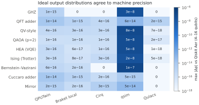

All nine families were compared at 4, 8, 12 and 16 qubits, up to 65 536 outcomes, with Qiskit Aer as the reference. The worst deviation was **1.2 × 10⁻¹⁴** for QPUTwin, ≤ 2.7 × 10⁻¹⁵ for Braket, Cirq and Qulacs, and 1.2 × 10⁻⁷ for qsim (single precision). All six simulators agree to rounding error.

### 2. Noisy density-matrix simulation: QPUTwin is the fastest

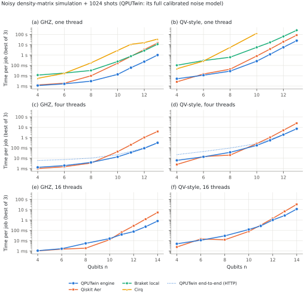

| Noisy circuit | QPUTwin | Qiskit Aer | Braket local | Cirq |
|---|---|---|---|---|
| GHZ, 12 qubits, 1 thread | **0.23 s** | 3.42 s | 2.68 s | 16.1 s |
| GHZ, 13 qubits, 1 thread | **1.02 s** | 15.0 s | 11.4 s | 35.6 s |
| QV-style, 12 qubits, 1 thread | **5.70 s** | 19.2 s | 63.8 s | > 120 s |
| QV-style, 13 qubits, 1 thread | **25.0 s** | 84.7 s | 252 s | > 120 s |
| GHZ, 13 qubits, 4 threads | **0.31 s** | 3.93 s | single-threaded | single-threaded |
| QV-style, 13 qubits, 4 threads | **7.18 s** | 24.7 s | single-threaded | single-threaded |

From 10 qubits, QPUTwin is **3.2–15× faster than Aer** on one thread (GHZ 12–15×, QV-style 3.2–3.4×), 10–22× faster than Braket and 35–500× faster than Cirq; on four threads it is 1.5–13× faster than Aer, and on sixteen, from 12 qubits, 1.4–6.8×. It achieves this while running a **richer** model: its full calibrated channel per native gate, versus one depolarising channel per U/CX for the others. At 4–8 qubits, where every job takes milliseconds, Aer is level or ahead, by up to 2.0× on one thread and 2.5× on four, and on sixteen threads up to 10 qubits.

### 3. Ideal statevector simulation

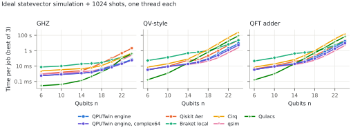

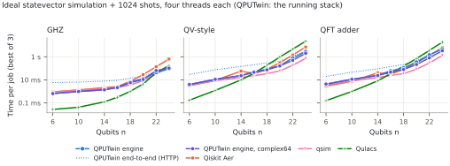

| Circuit | Threads | QPUTwin | QPUTwin c64 | Qiskit Aer | qsim (c64) | Qulacs | Braket | Cirq |
|---|---|---|---|---|---|---|---|---|
| GHZ, 24 qubits | 1 | 70 ms | **58 ms** | 2.09 s | 273 ms | 395 ms | 396 ms | 487 ms |
| QV-style, 24 qubits | 1 | 8.72 s | 5.26 s | 24.8 s | **2.48 s** | 86.6 s | 23.1 s | 249 s |
| QFT adder, 24 qubits | 1 | 16.2 s | 9.38 s | 23.3 s | **4.81 s** | 69.2 s | 18.9 s | 161 s |
| GHZ, 24 qubits | 4 | **92 ms** | 102 ms | 633 ms | 133 ms | 174 ms | | |
| QV-style, 24 qubits | 4 | 2.84 s | 2.01 s | 7.12 s | **0.74 s** | 22.6 s | | |
| QFT adder, 24 qubits | 4 | 4.82 s | 3.39 s | 6.24 s | **1.30 s** | 18.4 s | | |

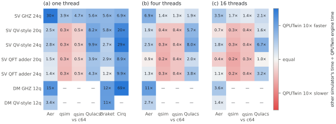

* **Shallow circuits (GHZ):** QPUTwin is the **fastest of six from 22 qubits** on one thread and at 24 qubits on four: at 24 qubits on one thread 3.9× faster than qsim, 5.6× than Qulacs and Braket, 6.9× than Cirq and 30× than Aer. Lazy activation means the chain touches a full-size state only once. Below that, Qulacs leads (its per-gate C++ calls cost microseconds), and qsim is ahead on four threads at 22 qubits.
* **Deep circuits (QV-style, QFT adder):** QPUTwin is the **second-fastest of six** at large widths. At 20–24 qubits it is 1.4–2.8× faster than Qiskit Aer on one thread (on four, 1.9–2.5× on QV-style circuits, while Aer is up to 1.15× ahead on the QFT adder at 20–22 qubits), 1.2–5.8× faster than Braket, 3.9–9.9× faster than Qulacs and 9–29× faster than Cirq. Only **qsim** is faster: by 3.2–3.6× against QPUTwin's default double precision, and by **1.9–2.2× at matched (single) precision** on one thread (2.6–2.7× on four). qsim is hand-vectorised C++; QPUTwin's 5-qubit blocks are already dense BLAS products, so closing the rest would need hand-written SIMD kernels.
* **Small widths (10–14 qubits):** on deep circuits Qulacs, qsim and Aer are ahead; QPUTwin's engine takes tens of milliseconds there, mostly Python planning. A QPUTwin job costs milliseconds end to end anyway, dominated by HTTP, validation and native compilation, not simulation.

#### All 16 vCPUs

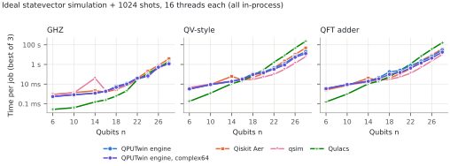

With every simulator given all 16 threads of the host (QPUTwin in-process, up to 28 qubits):

| Circuit | QPUTwin | QPUTwin c64 | Qiskit Aer | qsim (c64) | Qulacs |
|---|---|---|---|---|---|
| GHZ, 24 qubits | **57 ms** | 67 ms | 199 ms | 95 ms | 120 ms |
| GHZ, 28 qubits | **1.17 s** | **1.17 s** | 3.86 s | 1.61 s | 2.01 s |
| QV-style, 28 qubits | 19.4 s | 12.8 s | 48.5 s | **6.28 s** | 233 s |
| QFT adder, 28 qubits | 29.4 s | 18.0 s | 38.8 s | **10.5 s** | 164 s |
| Noisy DM, GHZ 14 qubits | **0.81 s** | | 5.49 s | | |
| Noisy DM, QV-style 14 qubits | **11.6 s** | | 32.9 s | | |

* **Shallow wide circuits:** QPUTwin is fastest at 24 and 28 qubits (1.7× and 1.4× ahead of qsim); at 26 qubits qsim (0.40 s) and Qulacs (0.50 s) are ahead of QPUTwin (0.52–0.61 s).
* **Deep circuits:** qsim leads at every width, by 2.0× (QV-style) and 1.7× (QFT adder) at 28 qubits at matched precision and by more at smaller widths. QPUTwin beats Aer from 24 qubits (2.5× on QV-style and 1.3× on the QFT adder at 28; Aer is ahead at 20 qubits and on the QFT adder at 22) and Qulacs everywhere above 20 (1.5–12×).
* **Noisy density matrices:** QPUTwin is fastest from 12 qubits (1.4–6.8× faster than Aer); below that Aer's lower per-job overhead wins.

#### How wide each simulator goes

`run_capacity.py` runs each simulator with the host to itself (16 threads, 62.8 GiB, the QPUTwin stack stopped), one fresh process per point, and raises the width until the first failure; a point that takes more than 20 minutes ends the series.

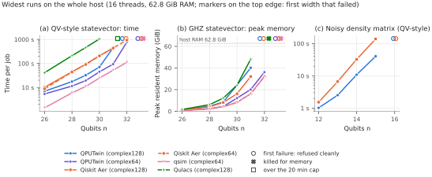

| Simulator | Widest statevector (GHZ / QV-style time) | Peak memory at that width | First failure |
|---|---|---|---|
| QPUTwin, complex128 | **31** (15.4 s / 452 s) | 40–48 GiB, single-buffer | 32: **refused** with `ResourceLimitError` |
| QPUTwin, complex64 | **32** (22.3 s / 775 s) | 36–40 GiB, single-buffer | 33: **refused** |
| Qiskit Aer, complex128 | 31 (37.2 s / 438 s) | 32 GiB | 32: refused (`Insufficient memory`) |
| Qiskit Aer, complex64 | 32 (72.2 s / 942 s) | 32 GiB | 33: refused |
| qsim (complex64) | 32 (27.5 s / **112 s**) | 32 GiB | 33: **killed** by the OS for memory |
| Qulacs, complex128 | 31 GHZ (17.4 s); 30 QV-style (1 047 s) | 48 GiB | GHZ 32: **killed**; QV-style 31: over 20 min |
| Noisy density matrix: QPUTwin / Aer | 15 / 15 (QV-style 40.5 s / 139 s) | 32 / 16 GiB | 16: both refused |

* **Everyone reaches about the same width**: the state, not the code, sets it. QPUTwin needs its [single-buffer mode](../guide/engines.md#memory-and-width-limits) to get there; with two buffers it would stop one qubit earlier.
* **How a run ends differs.** QPUTwin and Aer check memory first and return an error. qsim and Qulacs allocate and are killed by the kernel, which in a shared service takes the worker, and every job queued on it, down.
* **Speed at the edge:** on the shallow GHZ circuit QPUTwin is fastest at 28–29 qubits and at the 32-qubit limit (22.3 s against 27.5 s for qsim), while qsim is ahead at 30 qubits (6.8 s against 10.5–12.9 s) and level at 31; on deep QV-style circuits qsim leads (31 qubits, complex64: 53 s, QPUTwin 94 s, Aer 437 s). The single-buffer mode costs time on deep circuits (31-qubit QV-style in complex128: 452 s, against 71 s at 30 qubits with two buffers).

!!! note "Memory estimate"
    The fused statevector writes its probabilities into the state's own memory, so its memory estimate is 2.25 × state + 128 MiB (measured peak 32.2 GiB of an estimated 36.1 GiB at 31 qubits). A 31-qubit complex64 QV-style circuit therefore runs with two buffers, in 94 s.

### 4. The physics cross-validates

`noise_models.py` builds a Qiskit Aer model from the **same calibration the running containers report** (`GET /v1/backends/{id}`):
- **Inputs:** gate fidelities and durations, T1/T2 and readout errors.
- **Recipe:** the conventional per-gate model, thermal relaxation then depolarising noise solved to hit the published average gate fidelity, written with Qiskit's own channel algebra.
- **Self-check:** each gate matches its target fidelity to 10⁻⁹.

It runs QPUTwin's **identical compiled circuit** (same native gates, same physical qubits) and uses each qubit's and coupler's own values on the IBM and Google twins. The comparison covers six families at 3–8 qubits on all seven twins: 231 cases, with 100 000 shots on each side.

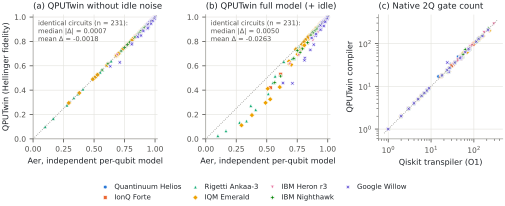

| 231 cases, identical circuits | Median \|Δ fidelity\| | Mean | Max \|Δ\| |
|---|---|---|---|
| QPUTwin **without** idle noise vs Aer-matched | **0.0007** | 0.0027 | 0.083 |
| QPUTwin full model vs Aer-matched | 0.0050 | −0.026 (signed) | 0.255 |

| Device | Mean \|Δ\| (no idle vs Aer) | Mean idle-noise penalty | Max idle-noise penalty |
|---|---|---|---|
| Quantinuum Helios | 0.0003 | 0.000 | 0.000 |
| IonQ Forte | 0.0008 | 0.015 | 0.108 |
| Rigetti Ankaa-3 | 0.0015 | 0.045 | 0.190 |
| IQM Emerald | 0.0013 | 0.049 | 0.201 |
| IBM Heron r3 | 0.0005 | 0.015 | 0.078 |
| IBM Nighthawk | 0.0007 | 0.017 | 0.104 |
| Google Willow | 0.0140 | 0.030 | 0.172 |

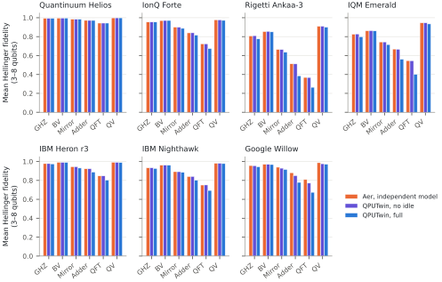

* **Two independent implementations agree.** Without idle decoherence, QPUTwin and the Aer model match to a median of 0.0007 in fidelity. Willow differs most (mean 0.014), because QPUTwin also applies Google's per-coupler coherent CZ angle errors, which the gate-local Aer recipe has no term for. The vendor's own model, below, does have them.
* **QPUTwin models what the standard recipe misses.** It applies relaxation while qubits wait in a real ASAP schedule with each device's parallelism limits. This costs up to **0.20** in fidelity on Ankaa-3 and Emerald, 0.08–0.17 on the IBM and Google twins, and up to 0.11 on IonQ Forte, whose two-qubit gates run one at a time.

### 5. The vendors' own noise models

For the three twins built from vendor snapshots there is a stronger reference: the noise models IBM and Google ship for the **same snapshots**. Qiskit Aer's `NoiseModel.from_backend` builds IBM's model from `fake_boston` (Heron r3) and `fake_miami` (Nighthawk), and Cirq's `NoiseModelFromGoogleNoiseProperties` builds Google's from `willow_pink`. Each runs QPUTwin's compiled circuit unchanged on the same physical qubits (33 cases per twin, 100 000 shots). Two further references bound the result: a **sampling floor** (the vendor model against itself with another seed) and a **medians-only** twin, an Aer model with one median value per gate type, as a twin without per-qubit data would be.

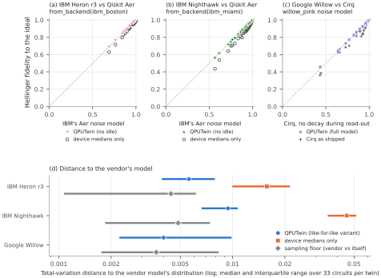

| Twin | Vendor model | Median \|Δ fidelity\| | Max \|Δ\| | Median TVD | Sampling floor | Medians-only: median TVD / max \|Δ\| |
|---|---|---|---|---|---|---|
| IBM Heron r3 | Aer `from_backend(fake_boston)` | **0.0014** | 0.007 | 0.0056 | 0.0044 | 0.0158 / 0.062 |
| IBM Nighthawk | Aer `from_backend(fake_miami)` | **0.0011** | 0.011 | 0.0094 | 0.0049 | 0.0454 / 0.131 |
| Google Willow | Cirq, `willow_pink` | **0.0014** | 0.026 | 0.0040 | 0.0036 | 0.0468 / 0.161 |

* **The twins reproduce the vendors' models.** The median fidelity difference is at most 0.0014 and the worst case 0.026. On Heron and Willow the total-variation distance is close to the sampling floor; on Nighthawk it is about two floors.
* **Per-qubit data matter.** A twin built from the same snapshots' device medians has 2.8 (Heron) and 4.8 (Nighthawk) times the total-variation distance of the per-qubit twin and differs by up to 0.06–0.16 in fidelity. The compiled circuits are placed by the [calibration-aware re-layout](../guide/routing.md#calibration-aware-re-layout), so they avoid the snapshots' poorest qubits, which the medians cannot see.
* **Cirq double-counts readout-time decay.** Cirq's model also decays every qubit for the 600 ns of each measurement, on top of a measured readout error that already contains that decay. QPUTwin does not count it twice, so the table compares with Cirq's model with that decay off. Cirq as shipped predicts on average 0.027 lower fidelity (up to 0.095). The IBM rows compare QPUTwin without idle noise, because neither vendor model idles an unscheduled circuit.

These are checks against the vendors' published models, not against hardware.

### 6. Device emulation end to end: the vendors' own workflows

The sections above compare engines. To predict what a circuit will do on a specific IBM or Google processor, a user runs a whole workflow: the vendor's compiler for that device, then a noisy simulation with the vendor's noise model of the same snapshot. `vendor_workflow` times exactly that against one QPUTwin job for the same OpenQASM program:

| Twin | Vendor workflow | QPUTwin |
|---|---|---|
| IBM Heron r3 | `qiskit.transpile(backend=FakeBoston, optimization_level=1)` + `AerSimulator.from_backend` (Aer picks density matrix or noisy statevector) | one job, automatic engine |
| IBM Nighthawk | the same with `FakeMiami` | one job |
| Google Willow | Cirq `RouteCQC` + `CZTargetGateset` + qsim with `NoiseModelFromGoogleNoiseProperties` (or Cirq's `DensityMatrixSimulator`, to 6 qubits) | one job |

Four threads each, per-device simulator objects built outside the timed region, six families at 4–14 qubits, best of three. Cirq has no barrier, so the Google workflow optimises each barrier-delimited segment separately; otherwise its optimiser cancels a mirror circuit to nothing.

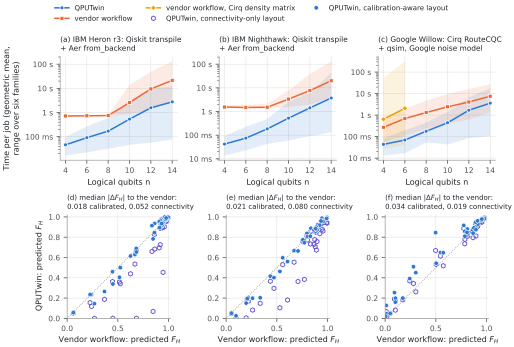

* **Time per job:** QPUTwin was faster in **107 of 108 cases**, by a geometric mean of **7.1× (Heron), 10.2× (Nighthawk) and 4.8× (Willow)** and by up to 134×. At small widths the vendors' cost is per-job overhead in the simulator, not compilation (Qiskit transpiles these circuits in 5–12 ms): Aer spends 0.7 s per job on Heron and 1.4–1.9 s on Nighthawk even at four qubits, where a whole QPUTwin job takes 13–270 ms. At 12–14 qubits the batched trajectories decide it: QAOA-14 on Heron takes 4.0 s against 42 s, the QFT adder at 14 qubits 12.4 s against 131 s.
* **The one loss:** a 10-qubit mirror circuit on Heron (2.8 s against 2.5 s), which QPUTwin's router spread over 15 physical qubits while Qiskit used 10.
* **Cirq's density matrix:** level on a 4-qubit mirror circuit, up to 2 300× slower elsewhere (QAOA-6: 314 s against 0.14 s).
* **Predictions:** the two pipelines compile, place and model noise differently, so their predicted fidelities need not agree. With the calibration-aware re-layout, QPUTwin lies close to IBM's workflow (median |ΔF_H| 0.018 on Heron, 0.021 on Nighthawk, against 0.052 and 0.080 with connectivity-only placement), because Qiskit's level-1 pipeline also places by calibration. On Willow the re-layout moves QPUTwin *away* from Google's workflow (0.034 against 0.019): Cirq's router places by connectivity only, so on better qubits QPUTwin predicts higher fidelity, for example 0.25 against 0.09 for a 12-qubit mirror circuit.

### 7. Using the whole host: device-emulation throughput

A batch of 96 jobs (six families × 4, 6, 8, 10 qubits × four seeds) runs 16 at a time on the 16 vCPUs: the vendor workflow in 16 single-threaded processes, QPUTwin as 16 single-CPU worker replicas of the device behind one orchestrator with 16 concurrent clients.

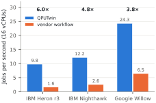{ width="520" }

| Twin | QPUTwin | Vendor workflow | Ratio | Median job (QPUTwin / vendor) |
|---|---|---|---|---|
| IBM Heron r3 | **9.8 jobs/s** | 1.6 jobs/s | **6.0×** | 0.15 s / 1.07 s |
| IBM Nighthawk | **12.2 jobs/s** | 2.6 jobs/s | **4.8×** | 0.15 s / 2.53 s |
| Google Willow | **24.3 jobs/s** | 6.5 jobs/s | **3.8×** | 0.15 s / 0.88 s |

Noisy jobs above the density-matrix limit run on the [batched, fused trajectory executor](../guide/engines.md#batched-fused-trajectories), and the cost model picks the cheaper engine per job.

### 8. Compilation: QPUTwin's router against the Qiskit transpiler (O1)

| QPUTwin's native two-qubit gate count, compared with Qiskit's (231 cases) | Cases |
|---|---|
| lower | **48** (mostly QFT adder: 202 against 229 on Emerald at 8 qubits, 195 against 222 on Heron at 7; also Cuccaro adder, QV-style, mirror) |
| equal | 172 |
| higher | 11 (Helios Cuccaro adder: 2–6 more ZZ gates; on Heron, Nighthawk, Emerald and Willow a few QFT, QV-style, adder and mirror cases, up to 12 more) |
| **total over all cases** | **8 433 against 8 652 (−2.5 %)** |

The Helios gap comes from Qiskit re-synthesising two-qubit blocks (KAK) around decomposed Toffolis, which QPUTwin's peephole pass does not do; the lattice cases are SABRE trials that Qiskit's own SABRE happens to beat.

## Where QPUTwin stands

| Dimension | Result |
|---|---|
| Correctness | identical to all five simulators (≤ 1.2 × 10⁻¹⁴) |
| Device emulation end to end (IBM, Google twins) | **faster than the vendors' own workflows in 107 of 108 jobs** (geometric mean 4.8–10.2×, up to 134×); **3.8–6.0× their throughput** on the whole host |
| Noisy density-matrix speed | **fastest of the four** from 10–12 qubits with a richer noise model (3.2–15× faster than Aer on one thread, 1.4–6.8× on 16); Aer is level or ahead below that |
| Wide noisy circuits (trajectories) | batched, fused trajectories: a 12-qubit noisy QAOA job on Heron in ~3 s, exact against the density matrix |
| Ideal statevector, shallow circuits | **fastest** at 24 qubits on 1, 4 and 16 threads, at 28–29 and at the 32-qubit limit on 16 (3.9× faster than qsim at 24 on one thread); qsim is level or ahead at 26 and 30–31 qubits |
| Ideal statevector, deep circuits | **2nd**, behind qsim only (1.9–2.2× at matched precision on one thread, 1.7–2.0× at 28 qubits on 16); faster than Aer from 22–24 qubits, and than Qulacs, Braket and Cirq |
| Largest job on the host | the same widths as Aer, qsim and Qulacs (31 qubits complex128, 32 complex64, 15-qubit density matrix), **refused cleanly** beyond, where qsim and Qulacs are killed for memory |
| Calibrated device noise | cross-validated against an independent Aer model (median 0.0007) and, for IBM and Google, against the vendors' own models (median ≤ 0.0014); adds schedule-aware idle decoherence the others omit |
| Routing / native compilation | 2.5 % fewer two-qubit gates than the Qiskit transpiler (O1) overall; calibration-aware placement on the snapshot twins |
| Device fidelity features | native gates, calibrated noise with provenance, gate timing, an HTTP service with telemetry: none of the others combine these |

QPUTwin is not faster than *every* simulator at *everything*. qsim's hand-vectorised C++ stays ahead on deep ideal circuits at every thread count, Qulacs on small ones, and Aer on noisy jobs below about ten qubits and on the 20–22-qubit QFT adder at four and sixteen threads. QPUTwin is the fastest on noisy density matrices from about ten qubits and on shallow wide circuits, and for its actual purpose, emulating a specific calibrated QPU end to end, it is several times faster than the vendors' own workflows and the most complete of the tools compared.

## Limitations of this comparison

* QPUTwin's 4-thread numbers come from the service (engine time from telemetry); the others run in-process. Single-thread QPUTwin numbers use the identical code in-process.
* QPUTwin simulates its compiled native sequence; the others simulate the U/CX list. Each simulates what it would in practice.
* The noisy-speed test uses different noise models (§2): QPUTwin's is the more expensive one.
* Vendor cloud emulators (Quantinuum Nexus, IonQ cloud simulator, IQM Resonance) need accounts and run remotely, so they are not included. For the four median-based twins the calibration-matched Aer model is the reproducible stand-in; for the IBM and Google twins the vendors' own SDK noise models are used.
* One host shared with the QPUTwin stack (except the capacity sweep, which stops it). Ratios transfer better than absolute times.
* The vendor workflows use the vendors' public SDK emulation paths (Qiskit Aer, Cirq, qsim), not their cloud services; each tool used its own default engine choice.
* qsim ran at its default fusion setting only.

## Reproduce

The comparison lives in its own folder with a separate environment, so Qiskit, Braket, Cirq, qsim and Qulacs never enter QPUTwin's dependencies:

```bash
docker compose up -d --wait                                # the QPUTwin stack must be running
cd comparison && uv sync
uv run python run_comparison.py correctness sv_speed dm_speed    # one thread, ~30 min
uv run python run_comparison.py noise_xval vendor_xval            # independent Aer and vendor-model cross-checks
COMPARE_THREADS=4 uv run python run_comparison.py vendor_workflow    # the vendors' own workflows, end to end
COMPARE_THREADS=16 uv run python run_comparison.py sv_speed dm_speed  # all 16 threads
WORKFLOW_BACKEND=ibm_heron WORKFLOW_PARALLEL=16 uv run python run_comparison.py workflow_throughput  # needs 16 one-CPU replicas
uv run python run_capacity.py                                     # stop the stack first: widest runs, one process per point
COMPARE_THREADS=4 uv run python run_comparison.py sv_speed dm_speed  # four threads, ~5 min
uv run python plot_comparison.py
```

Code, raw JSON results, CSVs and the PDF/SVG/PNG figures are in `comparison/` (see its README).
